# BAB IV HASIL DAN PEMBAHASAN

Bab ini menguraikan hasil pelaksanaan kerja praktik di Toko NF Harapan Rumbai beserta pembahasan rekayasa perangkat lunak secara menyeluruh. Uraian dimulai dari gambaran umum capaian sistem dan rekapitulasi kegiatan pelaksanaan, dilanjutkan dengan analisis sistem berjalan dan sistem usulan, perancangan aturan bisnis, pemodelan UML, perancangan basis data dan antarmuka, implementasi kode dan antarmuka aplikasi, hingga pengujian fungsional (*Black Box Testing*) serta pengujian penerimaan pengguna (*User Acceptance Testing*).

## 4.1. Hasil

Pelaksanaan kerja praktik di Toko NF Harapan Rumbai menghasilkan aplikasi web internal untuk pengelolaan transaksi penjualan kasir (*Point of Sale*), pencatatan persediaan barang, penerimaan barang dari pemasok, pemantauan hutang usaha kepada pemasok, serta penyusunan laporan operasional toko. Sistem ini dirancang khusus mengikuti alur kerja harian di Toko NF Harapan Rumbai yang melayani penjualan eceran dan grosir dengan berbagai variasi satuan jual, mulai dari satuan utuh (kilogram, bungkus, dus, karung) hingga takaran pecahan (1/2 kg dan 1/4 kg).

### 4.1.1. Gambaran Umum Hasil Kerja Praktik

Sebelum sistem ini dibangun, seluruh kegiatan transaksi di Toko NF Harapan Rumbai dicatat secara manual pada buku kas harian dan tumpukan nota kertas. Petugas kasir harus mengingat atau menanyakan harga eceran dan harga grosir kepada pemilik toko ketika pelanggan membeli barang dalam jumlah banyak atau dalam takaran pecahan. Selain itu, sisa stok barang di gudang maupun di etalase toko hanya diperkirakan secara visual, sementara nota tagihan dari pemasok yang belum lunas disimpan di dalam map tanpa daftar pengingat tanggal jatuh tempo.

Aplikasi web yang dihasilkan menyatukan kelima area kerja tersebut ke dalam satu pusat data terpadu yang dapat diakses melalui peramban web oleh pengguna internal toko sesuai pembagian tugasnya. Ringkasan capaian fungsional yang dihasilkan dari pelaksanaan kerja praktik ini disajikan pada Tabel 4.1.

**Tabel 4.1 Ringkasan Capaian Hasil Kerja Praktik pada Toko NF Harapan Rumbai**

| No. | Area Operasional | Kondisi Sebelum Sistem | Hasil Implementasi Sistem |
| --- | --- | --- | --- |
| 1 | Transaksi Kasir (*Point of Sale*) | Pencatatan penjualan masih ditulis tangan pada nota kertas dan buku kas harian; pemilihan harga eceran dan grosir dihitung manual menggunakan kalkulator. | Tersedia halaman kasir berbasis web yang memilih harga eceran atau grosir secara otomatis berdasarkan jumlah pembelian pelanggan, menghitung uang kembalian, dan menyiapkan struk siap cetak. |
| 2 | Pengelolaan Katalog & Multi-Satuan | Belum ada daftar barang terstruktur; konversi barang curah (1 kg, 1/2 kg, 1/4 kg) tidak tercatat terhadap stok induk. | Tersedia modul katalog barang, kategori, dan satuan jual dengan rasio konversi hingga empat angka desimal ke satuan dasar penyimpanan stok. |
| 3 | Pencatatan Persediaan Barang | Jumlah sisa stok hanya diperkirakan melalui pemeriksaan fisik rak ketika barang terlihat hampir habis. | Setiap transaksi penjualan, penerimaan barang masuk, pembatalan nota, dan penyesuaian fisik (*stock opname*) tercatat pada buku besar mutasi persediaan serta memperbarui saldo stok gudang secara otomatis. |
| 4 | Penerimaan Barang & Hutang Pemasok | Nota pembelian dari pemasok disimpan dalam map fisik; tagihan tempo sering terlewat karena tidak ada pengingat jatuh tempo. | Penerimaan barang dengan pembayaran sebagian (cicilan) atau belum dibayar (kredit) secara otomatis membentuk catatan hutang pemasok beserta pengingat jatuh tempo tujuh hari sebelumnya (H-7) dan penanda lewat jatuh tempo pada halaman utama. |
| 5 | Bukti Transaksi, Laporan & Jejak Audit | Rekapitulasi penjualan dan hutang pemasok harus dihitung ulang dari tumpukan nota; riwayat perubahan data tidak terlacak. | Tersedia penyimpanan terproteksi untuk lampiran foto atau PDF nota fisik, laporan operasional yang dapat diunduh dalam format CSV dan PDF, serta pencatatan jejak aktivitas pengguna atas setiap perubahan data. |

Sebagaimana dirangkum pada Tabel 4.1, sistem yang dibangun tidak hanya memindahkan pencatatan dari buku ke layar komputer, tetapi juga menghubungkan data antarbagian secara langsung. Ketika kasir menyelesaikan satu transaksi penjualan, saldo persediaan langsung berkurang sesuai satuan dasar barang dan nilai penjualan otomatis masuk ke dalam rekapitulasi harian pemilik toko.

### 4.1.2. Rekapitulasi Kegiatan Pelaksanaan Kerja Praktik (Logbook)

Rangkaian kegiatan kerja praktik dilaksanakan secara bertahap mengikuti metode *Waterfall* yang telah dijabarkan pada Bab III, dimulai dari pengamatan langsung dan wawancara di lokasi usaha hingga pengujian penerimaan pengguna bersama pemilik toko. Rincian kegiatan mingguan selama pelaksanaan kerja praktik disajikan pada Tabel 4.2.

**Tabel 4.2 Rekapitulasi Kegiatan Pelaksanaan Kerja Praktik (Logbook)**

| Minggu Ke- | Tahapan Pelaksanaan | Uraian Kegiatan Kerja Praktik | Luaran (*Output*) |
| --- | --- | --- | --- |
| 1 | Observasi & Wawancara Awal | Melakukan pengamatan langsung terhadap alur pelayanan kasir, pengecekan stok barang di rak, dan wawancara dengan pemilik toko (Ibu Emi Erawati) mengenai kendala pencatatan usaha. | Catatan hasil wawancara dan identifikasi masalah operasional toko. |
| 2 | Inventarisasi Dokumen & Aturan Usaha | Mengumpulkan contoh nota penjualan, nota pembelian dari pemasok, daftar barang sembako, variasi satuan jual (1 kg, 1/2 kg, 1/4 kg, dus, karung), serta aturan harga eceran dan grosir. | Daftar kebutuhan fungsional, non-fungsional, dan aturan bisnis inti toko. |
| 3 | Perancangan Proses & Pemodelan Sistem | Menyusun pemodelan sistem menggunakan *Use Case Diagram*, *Flowchart* proses bisnis usulan, *Activity Diagram*, *Sequence Diagram*, dan *Class Diagram*. | Dokumen spesifikasi *use case* dan diagram pemodelan proses sistem. |
| 4 | Perancangan Basis Data & Antarmuka | Merancang *Entity Relationship Diagram* (ERD), struktur 12 tabel basis data relasional, rancangan keluaran informasi, serta kerangka tampilan (*wireframe*) halaman aplikasi. | Rancangan struktur tabel basis data dan kerangka tampilan halaman aplikasi. |
| 5 | Implementasi Modul Fondasi & Katalog | Membangun fitur masuk sistem (*login*), pembagian hak akses empat peran pengguna, pengaturan profil toko, pengelolaan akun pegawai, kategori, satuan, barang multi-satuan, dan tingkatan harga. | Modul akses pengguna, administrasi toko, dan katalog barang aktif. |
| 6 | Implementasi Modul Kasir & Persediaan | Membangun halaman kasir *Point of Sale* (POS), perhitungan harga otomatis, buku besar mutasi persediaan, cetak struk penjualan, pembatalan nota penjualan, dan penyesuaian stok fisik. | Modul transaksi kasir, riwayat penjualan, mutasi stok, dan *stock opname*. |
| 7 | Implementasi Modul Pemasok, Penerimaan & Hutang | Membangun pengelolaan data pemasok, pencatatan penerimaan barang masuk, pembentukan catatan hutang otomatis, pencatatan pembayaran cicilan/pelunasan, unggah bukti nota, serta ekspor laporan CSV/PDF. | Modul pengadaan barang, hutang pemasok, arsip dokumen bukti, dan laporan. |
| 8 | Pengujian Sistem & Evaluasi Pengguna | Melaksanakan pengujian fungsional (*Black Box Testing*) pada 9 modul utama serta pengujian penerimaan pengguna (*User Acceptance Testing*) bersama pemilik dan staf Toko NF Harapan Rumbai. | Berita acara hasil pengujian *Black Box*, hasil UAT, dan laporan akhir KP. |

Tahapan kegiatan pada Tabel 4.2 menunjukkan bahwa perancangan aturan konversi satuan dan pencatatan hutang pemasok diselesaikan terlebih dahulu pada minggu kedua hingga keempat sebelum pembuatan program dimulai. Langkah ini diambil agar struktur penyimpanan data telah matang dan sesuai dengan cara kerja di Toko NF Harapan Rumbai.

## 4.2. Pembahasan

Bagian pembahasan menguraikan proses pengembangan perangkat lunak secara berurutan, dimulai dari analisis sistem yang sedang berjalan dan sistem yang diusulkan, spesifikasi kebutuhan fungsional dan non-fungsional, pembagian hak akses pengguna, perancangan aturan bisnis inti, pemodelan proses dan basis data, implementasi antarmuka aplikasi, hingga hasil pengujian sistem.

### 4.2.1. Analisis Sistem

Analisis sistem dilakukan untuk memetakan kelemahan alur kerja manual di Toko NF Harapan Rumbai dan menerjemahkannya menjadi spesifikasi kebutuhan sistem yang terukur. Fokus utama analisis terletak pada bagaimana transaksi harian dapat dicatat dengan cepat oleh kasir tanpa mengorbankan ketelitian saldo stok barang dan catatan hutang kepada pemasok.

#### 4.2.1.1. Analisis Sistem yang Sedang Berjalan dan Sistem Usulan

Pada alur manual yang berjalan sebelumnya, proses penjualan di kasir, pemeriksaan stok di gudang, dan pencatatan tagihan pemasok berlangsung secara terpisah tanpa saling terhubung. Ketika barang datang dari pemasok, petugas hanya memeriksa kecocokan fisik barang dengan nota kertas lalu menyusun barang ke rak atau gudang. Apabila nota pembelian tersebut dibayar secara tempo atau dicicil, pemilik toko harus membuka kembali map berisi kumpulan nota kertas satu per satu untuk memeriksa sisa tagihan dan tanggal jatuh temponya. Perbandingan antara prosedur manual yang berjalan sebelumnya dan mekanisme pada sistem yang diusulkan dirinci pada Tabel 4.3.

**Tabel 4.3 Perbandingan Prosedur Operasional Sistem Berjalan dan Sistem Usulan**

| No. | Aspek Prosedur | Sistem yang Sedang Berjalan (Manual) | Sistem yang Diusulkan (Berbasis Web) |
| --- | --- | --- | --- |
| 1 | Penentuan Harga Jual (Eceran vs Grosir) | Kasir menanyakan atau menghafal batas pembelian grosir tiap barang lalu mengalikan harga secara manual menggunakan kalkulator. | Sistem memeriksa jumlah pembelian pelanggan terhadap batas kuantitas minimum pada daftar harga barang dan menerapkan harga grosir atau harga eceran secara otomatis. |
| 2 | Penjualan Barang Curah / Takaran Pecahan | Penjualan gula atau telur dalam takaran 1/2 kg dan 1/4 kg dicatat sebagai nominal uang saja tanpa memotong sisa stok kilogram secara presisi. | Setiap satuan jual memiliki rasio konversi ke satuan dasar (seperti 1 utuh, 0,5 kilogram, dan 0,25 kilogram) sehingga penjualan takaran pecahan langsung memotong saldo stok dasar secara akurat. |
| 3 | Pencatatan Barang Masuk & Tagihan Pemasok | Nota penerimaan barang disimpan di map kertas; status lunas, bayar sebagian, atau belum dibayar hanya ditulis tangan di pojok nota. | Pencatatan penerimaan barang langsung menambah saldo stok gudang dan secara otomatis membuat catatan hutang usaha apabila nilai pembayaran awal kurang dari nilai total tagihan nota. |
| 4 | Pemantauan Jatuh Tempo Hutang Pemasok | Pemilik toko harus membuka map nota secara berkala untuk memeriksa nota mana yang mendekati tanggal jatuh tempo. | Halaman utama dan daftar hutang menampilkan peringatan otomatis untuk tagihan yang jatuh tempo dalam 7 hari ke depan (H-7) maupun yang sudah melewati batas jatuh tempo. |
| 5 | Koreksi Kesalahan Transaksi & Bukti Nota | Nota yang salah tulis dicoret atau dibuang tanpa catatan alasan; nota fisik mudah terselip atau pudar. | Koreksi kesalahan wajib melalui prosedur pembatalan resmi (*void*) disertai alasan tertulis dan pengembalian saldo stok otomatis; foto atau PDF bukti nota disimpan secara digital. |

Perbandingan pada Tabel 4.3 memperlihatkan bahwa sistem yang diusulkan menghilangkan ketergantungan pada hafalan petugas kasir maupun pemeriksaan berkas nota secara manual. Seluruh perhitungan harga bertingkat, konversi takaran pecahan, pemotongan saldo persediaan, dan pembentukan catatan hutang pemasok dikerjakan secara terpadu oleh sistem.

#### 4.2.1.2. Analisis Kebutuhan Fungsional

Kebutuhan fungsional mendefinisikan layanan dan fitur yang wajib disediakan oleh sistem agar seluruh proses operasional Toko NF Harapan Rumbai dapat berjalan dengan lancar. Setiap kebutuhan diberi kode identifikasi (KF-01 hingga KF-15) untuk memudahkan penelusuran pada tahap perancangan dan pengujian. Rincian kebutuhan fungsional sistem disajikan pada Tabel 4.4.

**Tabel 4.4 Spesifikasi Kebutuhan Fungsional Sistem**

| Kode | Nama Fungsi / Fitur | Aktor Pengguna | Deskripsi Kebutuhan Fungsional |
| --- | --- | --- | --- |
| KF-01 | Autentikasi & Keamanan Sesi | Seluruh Pengguna | Sistem menyediakan halaman masuk (*login*) menggunakan nama pengguna atau surel dan kata sandi, membatasi percobaan masuk yang gagal secara berulang, menolak akun yang sudah dinonaktifkan, serta mendukung kebijakan wajib ganti kata sandi awal. |
| KF-02 | Halaman Ringkasan & Pengingat Jatuh Tempo | Pemilik Toko, Petugas Persediaan, Kasir, Pemeriksa Internal | Sistem menampilkan ringkasan penjualan harian, penerimaan barang masuk, daftar barang dengan stok menipis, serta pengingat tagihan pemasok yang mendekati jatuh tempo (H-7) atau telah melewati tanggal jatuh tempo. |
| KF-03 | Manajemen Pengguna & Pengaturan Toko | Pemilik Toko | Sistem memungkinkan pemilik toko menambah akun pegawai baru, mengatur peran kerja, menonaktifkan akun pegawai yang sudah tidak bertugas, mengatur ulang kata sandi, serta memperbarui identitas toko untuk tajuk struk dan laporan. |
| KF-04 | Manajemen Kategori & Satuan Barang | Pemilik Toko, Petugas Persediaan | Sistem menyediakan pengelolaan data induk kategori barang dan satuan ukur (seperti buah/bungkus, kilogram, liter, dus, dan karung) beserta ketelitian angka desimalnya. |
| KF-05 | Manajemen Barang & Konversi Multi-Satuan | Pemilik Toko, Petugas Persediaan | Sistem mendukung pengelolaan data barang beserta daftar satuan jual yang memiliki rasio konversi ke satuan dasar penyimpanan stok, termasuk satuan takaran pecahan setengah kilogram (0,5 kg) dan seperempat kilogram (0,25 kg). |
| KF-06 | Manajemen Harga Eceran & Grosir Bertingkat | Pemilik Toko, Petugas Persediaan | Sistem menyimpan tingkatan harga eceran dan harga grosir pada setiap satuan jual beserta syarat jumlah pembelian minimum dan tanggal mulai berlakunya harga. |
| KF-07 | Transaksi Penjualan Kasir (*Point of Sale*) | Pemilik Toko, Petugas Persediaan, Kasir | Sistem menyediakan halaman kasir untuk memilih barang dan satuan jual, menerapkan harga eceran atau grosir secara otomatis, memeriksa kecukupan saldo stok gudang, mencatat metode pembayaran (tunai, transfer bank, atau QRIS), serta menghitung uang kembalian pelanggan. |
| KF-08 | Pencetakan Struk & Riwayat Penjualan | Pemilik Toko, Petugas Persediaan, Kasir, Pemeriksa Internal | Sistem menampilkan rincian transaksi penjualan yang telah selesai beserta tampilan struk belanja yang siap dicetak melalui peramban web. |
| KF-09 | Pembatalan (*Void*) Transaksi Terkontrol | Pemilik Toko | Sistem menyediakan fitur pembatalan resmi pada transaksi penjualan, penerimaan barang, dan pembayaran hutang pemasok dengan kewajiban mengisi alasan pembatalan serta mengembalikan saldo stok dan sisa hutang secara otomatis. |
| KF-10 | Buku Besar Persediaan Barang | Pemilik Toko, Petugas Persediaan, Pemeriksa Internal | Sistem menampilkan saldo stok barang terkini dan riwayat keluar-masuk barang secara kronologis yang tidak dapat dihapus untuk setiap penambahan maupun pengurangan persediaan. |
| KF-11 | Penyesuaian Stok Fisik (*Stock Opname*) | Pemilik Toko | Sistem memungkinkan pemilik toko mencatat hasil perhitungan ulang stok fisik di gudang, barang rusak, atau barang kedaluwarsa yang langsung menyesuaikan saldo persediaan barang. |
| KF-12 | Manajemen Data Pemasok | Pemilik Toko, Petugas Persediaan | Sistem menyediakan pengelolaan informasi pemasok barang yang mencakup nama perusahaan pemasok, nama narahubung, nomor telepon, alamat pengiriman, dan catatan kerja sama. |
| KF-13 | Pencatatan Penerimaan Barang Masuk | Pemilik Toko, Petugas Persediaan | Sistem mencatat barang masuk dari pemasok, mengubah jumlah beli ke satuan dasar untuk menambah saldo stok gudang, serta membentuk catatan hutang usaha secara otomatis apabila nota belum dibayar lunas. |
| KF-14 | Manajemen Hutang Pemasok & Bukti Bayar | Pemilik Toko, Petugas Persediaan, Pemeriksa Internal | Sistem mencatat tagihan hutang pemasok, tanggal jatuh tempo pembayaran, riwayat pembayaran cicilan atau pelunasan, serta penyimpanan terproteksi untuk berkas bukti nota atau bukti transfer. |
| KF-15 | Laporan Operasional, Ekspor & Jejak Audit | Pemilik Toko, Petugas Persediaan, Pemeriksa Internal | Sistem menyajikan laporan penjualan, laporan persediaan, laporan penerimaan barang, dan laporan hutang pemasok yang dapat diunduh ke format CSV maupun PDF, serta menampilkan jejak aktivitas pengguna. |

Kelima belas kebutuhan fungsional pada Tabel 4.4 mencakup siklus penuh operasional Toko NF Harapan Rumbai, mulai dari barang diterima dari pemasok, disimpan sebagai stok dasar di gudang, dijual melalui kasir dalam berbagai satuan eceran maupun grosir, hingga dilunasi tagihan pemasoknya dan dilaporkan kepada pemilik toko.

#### 4.2.1.3. Analisis Kebutuhan Non-Fungsional

Selain fungsi bisnis utama, sistem harus memenuhi sejumlah batasan kualitas operasional agar aman digunakan di lingkungan toko dan menjaga keutuhan data keuangan maupun persediaan barang. Spesifikasi kebutuhan non-fungsional dirinci pada Tabel 4.5.

**Tabel 4.5 Spesifikasi Kebutuhan Non-Fungsional Sistem**

| Kode | Aspek Kualitas | Spesifikasi Kebutuhan Non-Fungsional |
| --- | --- | --- |
| KNF-01 | Keamanan Akun & Sesi Pengguna | Kata sandi pengguna wajib disimpan dalam bentuk terenkripsi satu arah, seluruh formulir pengiriman data dilindungi dari pemalsuan permintaan lintas situs, dan percobaan masuk dibatasi maksimal 5 kali per menit untuk mencegah upaya penebakan kata sandi. |
| KNF-02 | Pengendalian Hak Akses Berbasis Peran | Setiap halaman dan tindakan di dalam sistem wajib memeriksa hak akses pengguna sesuai perannya sehingga petugas kasir tidak dapat mengakses halaman administrasi akun, pengadaan barang, maupun penyesuaian stok fisik. |
| KNF-03 | Keutuhan Transaksi & Pencegahan Kiriman Ganda | Seluruh proses yang mengubah saldo stok dan nilai keuangan dijalankan dalam satu kesatuan transaksi utuh disertai penguncian antrean data dan penanda transaksi unik untuk mencegah pencatatan ganda akibat tombol simpan yang tertekan dua kali. |
| KNF-04 | Keamanan Berkas Lampiran Bukti Nota | Berkas bukti nota dan bukti pembayaran disimpan pada ruang penyimpanan privat yang tidak dapat diakses publik secara langsung, diperiksa kesesuaian format aslinya (JPG, PNG, atau PDF) dengan ukuran maksimal 8 MB, serta hanya dapat dibuka oleh pengguna berwenang. |
| KNF-05 | Keterlacakan Riwayat Aktivitas (*Auditability*) | Transaksi yang telah disimpan tidak boleh dihapus secara permanen dari basis data; setiap pembuatan transaksi, perubahan harga, pembatalan nota, dan pengelolaan akun pengguna wajib terekam pada catatan jejak audit lengkap dengan waktu dan identitas pelakunya. |
| KNF-06 | Kemudahan Penggunaan & Kejelasan Tampilan | Antarmuka disajikan dalam bahasa Indonesia yang mudah dipahami, responsif pada layar komputer kasir maupun perangkat tablet atau ponsel pemilik toko, serta menggunakan ikon vektor (SVG) yang bersih dan konsisten. |

Penerapan kebutuhan non-fungsional pada Tabel 4.5 memastikan bahwa sistem memiliki perlindungan berlapis terhadap kesalahan operasional yang sering terjadi di toko, seperti tombol simpan yang tertekan berulang kali saat jaringan melambat atau percobaan pengubahan data oleh pengguna yang tidak memiliki wewenang.

#### 4.2.1.4. Analisis Aktor dan Matriks Hak Akses Pengguna

Sistem membagi pengguna internal Toko NF Harapan Rumbai ke dalam empat peran kerja sesuai pembagian tanggung jawab di toko, yaitu Pemilik Toko, Petugas Persediaan (Admin Gudang), Kasir, dan Pemeriksa Internal (*Auditor*). Pembagian hak akses setiap peran terhadap fitur-fitur di dalam sistem ditunjukkan pada Tabel 4.6.

**Tabel 4.6 Matriks Hak Akses Pengguna Berdasarkan Peran (*Role-Based Access Control*)**

| No. | Modul / Fitur Operasional Sistem | Pemilik Toko | Petugas Persediaan | Kasir | Pemeriksa Internal |
| --- | --- | --- | --- | --- | --- |
| 1 | Melihat Ringkasan Eksekutif Toko & Pengingat Jatuh Tempo Hutang | Ya | Ringkasan Stok | Ringkasan Kasir | Ya |
| 2 | Mengelola Akun Pegawai & Pengaturan Profil Toko | Ya | Tidak | Tidak | Baca Saja |
| 3 | Melihat Daftar Barang, Kategori, & Satuan Ukur | Ya | Ya | Ya | Ya |
| 4 | Menambah & Mengubah Data Barang, Satuan Jual, & Tingkatan Harga | Ya | Ya | Tidak | Tidak |
| 5 | Mencatat Transaksi Penjualan pada Halaman Kasir | Ya | Ya | Ya | Tidak |
| 6 | Melihat Riwayat Transaksi Penjualan | Seluruh Nota | Seluruh Nota | Nota Hari Ini | Seluruh Nota |
| 7 | Membatalkan Transaksi Penjualan yang Telah Tercatat | Ya | Tidak | Tidak | Tidak |
| 8 | Melihat Saldo Persediaan & Riwayat Keluar-Masuk Barang | Ya | Ya | Tidak | Ya |
| 9 | Melakukan Penyesuaian Stok Fisik Barang (*Stock Opname*) | Ya | Tidak | Tidak | Tidak |
| 10 | Mengelola Data Pemasok & Mencatat Penerimaan Barang Masuk | Ya | Ya | Tidak | Baca Saja |
| 11 | Membatalkan Pencatatan Penerimaan Barang dari Pemasok | Ya | Tidak | Tidak | Tidak |
| 12 | Melihat Daftar Hutang Pemasok & Mencatat Pembayaran Cicilan | Ya | Ya | Tidak | Baca Saja |
| 13 | Membatalkan Pencatatan Pembayaran Hutang Pemasok | Ya | Tidak | Tidak | Tidak |
| 14 | Mengunggah & Melihat Berkas Lampiran Bukti Nota/Pembayaran | Ya | Ya | Tidak | Lihat Saja |
| 15 | Melihat & Mengunduh Laporan Operasional Toko (CSV/PDF) | Ya (CSV/PDF) | Lihat Laporan | Tidak | Ya (CSV/PDF) |
| 16 | Memeriksa Catatan Jejak Aktivitas Pengguna (*Audit Log*) | Ya | Tidak | Tidak | Ya |

Sebagaimana terlihat pada Tabel 4.6, tindakan sensitif yang berdampak langsung pada koreksi nilai persediaan atau pembatalan transaksi keuangan, seperti penyesuaian stok fisik (*stock opname*) dan pembatalan nota transaksi, hanya diberikan kepada Pemilik Toko. Sementara itu, Petugas Persediaan berfokus pada pengelolaan katalog barang, pencatatan barang masuk dari pemasok, dan pemantauan hutang usaha, sedangkan Kasir difokuskan pada pelayanan transaksi penjualan harian dan hanya dapat melihat riwayat nota yang dibuatnya pada hari berjalan.

#### 4.2.1.5. Perancangan Aturan Bisnis Inti Toko NF Harapan Rumbai

Berdasarkan hasil pengamatan langsung dan wawancara di Toko NF Harapan Rumbai, terdapat tiga aturan bisnis utama yang menjadi ciri khas operasional toko sembako grosir dan eceran ini. Ketiga aturan bisnis tersebut dirancang ke dalam logika pengolahan sistem sebagai berikut:

1. **Konversi Multi-Satuan dan Penjualan Takaran Pecahan Presisi Empat Desimal**: Setiap barang yang dijual di toko memiliki satu satuan dasar penyimpanan stok di gudang, misalnya satuan Kilogram untuk gula pasir curah dan telur ayam, atau satuan Bungkus untuk minyak goreng kemasan dan mie instan. Di atas satuan dasar tersebut, satu barang dapat memiliki beberapa pilihan satuan jual sekaligus sesuai kebiasaan belanja pelanggan rumah tangga maupun pedagang warung. Sebagai contoh, gula pasir curah dengan satuan dasar Kilogram dapat dijual dalam takaran eceran 1 kg (rasio konversi 1), takaran pecahan 1/2 kg (rasio konversi 0,5), takaran pecahan 1/4 kg (rasio konversi 0,25), maupun satuan besar berupa Karung 50 kg (rasio konversi 50). Setiap kali transaksi penjualan atau penerimaan barang disimpan, sistem secara otomatis mengalikan jumlah beli dengan rasio konversi satuan tersebut hingga ketelitian empat angka di belakang koma, sehingga pemotongan maupun penambahan saldo stok induk di gudang selalu presisi tanpa selisih pembulatan.

2. **Penentuan Harga Eceran dan Harga Grosir secara Otomatis**: Setiap satuan jual barang dapat memiliki daftar harga eceran untuk pembelian jumlah biasa serta harga grosir yang lebih hemat apabila pelanggan membeli mencapai batas kuantitas minimum tertentu (misalnya pembelian gula pasir minimal 10 kg atau minyak goreng minimal 12 bungkus). Ketika petugas kasir memilih barang dan memasukkan jumlah pembelian pada halaman kasir, sistem langsung memeriksa apakah jumlah pembelian tersebut telah mencapai atau melampaui batas kuantitas minimum harga grosir yang sedang berlaku. Apabila batas minimum terpenuhi, sistem secara otomatis menerapkan harga satuan grosir; sebaliknya apabila jumlah beli masih di bawah batas tersebut, sistem menerapkan harga satuan eceran. Seluruh perhitungan harga satuan dan total belanja diperiksa ulang oleh sistem saat transaksi disimpan agar tidak terjadi kesalahan hitung maupun perubahan harga secara sepihak.

3. **Pembentukan Hutang Pemasok Otomatis dan Pengingat Jatuh Tempo Tujuh Hari (H-7)**: Ketika pemilik toko atau petugas persediaan mencatat penerimaan barang masuk dari pemasok, sistem membandingkan nilai pembayaran awal (uang muka yang dibayarkan saat barang tiba) dengan nilai total tagihan pada nota pemasok. Apabila nilai pembayaran awal sama dengan nilai total tagihan nota, maka transaksi penerimaan barang langsung berstatus Lunas tanpa membentuk catatan hutang usaha. Sebaliknya, apabila nilai pembayaran awal bernilai nol (belum dibayar sama sekali) atau lebih kecil daripada nilai total tagihan nota (dibayar sebagian sebagai cicilan awal), sistem mewajibkan pengisian tanggal jatuh tempo dan secara otomatis membuat catatan hutang pemasok sebesar sisa tagihan yang belum terbayar. Seluruh catatan hutang yang masih memiliki sisa tagihan akan terus dipantau setiap hari oleh sistem: apabila tanggal jatuh tempo berada dalam rentang 7 hari ke depan, tagihan tersebut otomatis diberi penanda peringatan Segera Jatuh Tempo (H-7), dan apabila telah melewati tanggal jatuh tempo, tagihan diberi penanda Lewat Jatuh Tempo pada halaman ringkasan pemilik toko.

### 4.2.2. Perancangan Sistem

Tahap perancangan sistem menerjemahkan daftar kebutuhan fungsional, non-fungsional, dan aturan bisnis Toko NF Harapan Rumbai ke dalam rancangan terstruktur yang mencakup pemodelan proses berbasis *Unified Modeling Language* (UML) dan bagan alir (*flowchart*), perancangan skema basis data relasional, perancangan keluaran informasi (*output*), serta perancangan tata letak antarmuka pengguna (*wireframe*).

#### 4.2.2.1. Perancangan Proses dan Pemodelan Sistem (UML & Flowchart)

Pemodelan proses diawali dengan *Use Case Diagram* untuk memetakan interaksi antara empat aktor pengguna internal (Pemilik Toko, Petugas Persediaan, Kasir, dan Pemeriksa Internal) dengan dua belas layanan fungsional di dalam batas sistem (*system boundary*). Setiap aktor dihubungkan langsung ke layanan operasional yang sesuai dengan hak akses dan tanggung jawab kerjanya di toko. Pemodelan *Use Case Diagram* sistem ditunjukkan pada Gambar 4.1.

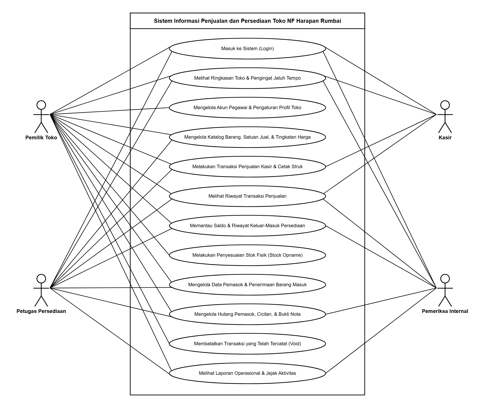
*Gambar 4.1 Use Case Diagram Sistem Informasi Penjualan dan Persediaan Toko NF Harapan Rumbai*

Berdasarkan Gambar 4.1, aktor Pemilik Toko memiliki cakupan akses paling menyeluruh terhadap kedua belas layanan sistem, termasuk wewenang khusus untuk melakukan penyesuaian stok fisik (*stock opname*), mengelola akun pegawai, serta membatalkan transaksi yang telah tercatat (*void*). Untuk memperjelas jalannya interaksi antara pengguna dan sistem pada dua alur bisnis utama, disusun spesifikasi *use case* untuk proses transaksi penjualan kasir pada Tabel 4.7 serta proses penerimaan barang dan pengelolaan hutang pemasok pada Tabel 4.8.

**Tabel 4.7 Spesifikasi Use Case Melakukan Transaksi Penjualan Kasir**

| Atribut Use Case | Uraian Spesifikasi |
| --- | --- |
| Kode & Nama *Use Case* | UC05 - Melakukan Transaksi Penjualan Kasir dan Cetak Struk |
| Aktor Utama | Kasir, Petugas Persediaan, Pemilik Toko |
| Deskripsi Singkat | Pengguna mencatat pembelian barang pelanggan pada halaman kasir dengan memilih satuan jual utuh atau takaran pecahan, sistem menerapkan harga eceran atau harga grosir secara otomatis, memotong saldo stok gudang, dan menyiapkan struk pembayaran. |
| Kondisi Awal (*Pre-condition*) | Pengguna telah berhasil masuk ke dalam sistem menggunakan akun aktif yang memiliki wewenang pelayanan kasir, serta daftar barang beserta satuan jual dan tingkatan harga telah terdaftar. |
| Alur Utama (*Basic Flow*) | 1. Pengguna membuka halaman penjualan kasir.
2. Sistem menampilkan daftar barang aktif beserta pilihan satuan jual, harga eceran, batas pembelian grosir, dan sisa stok tersedia.
3. Pengguna memilih barang dan satuan jual (misalnya 1 kg, 1/2 kg, 1/4 kg, atau bungkus) serta memasukkan jumlah pembelian pelanggan.
4. Sistem memeriksa apakah jumlah pembelian mencapai batas minimum harga grosir dan menerapkan harga satuan yang sesuai secara otomatis.
5. Pengguna memilih metode pembayaran (tunai, QRIS, atau transfer bank) dan memasukkan nominal uang yang diterima dari pelanggan.
6. Pengguna menekan tombol penyelesaian transaksi penjualan.
7. Sistem memeriksa keunikan transaksi, mengubah jumlah jual ke satuan dasar penyimpanan, mengunci antrean saldo stok, memotong saldo persediaan gudang, menyimpan nota penjualan beserta riwayat pembayarannya, lalu menampilkan halaman rincian nota dan tampilan cetak struk. |
| Alur Alternatif (*Exception Flow*) | 7a. Apabila sisa stok barang di gudang tidak mencukupi atau nominal uang pembayaran yang dimasukkan kurang dari total tagihan belanja, sistem menolak penyimpanan dan menampilkan pesan peringatan pada layar kasir. |
| Kondisi Akhir (*Post-condition*) | Nota penjualan tersimpan dengan nomor transaksi unik, saldo stok barang di gudang berkurang sesuai satuan dasar, dan riwayat keluar barang tercatat pada buku besar persediaan. |

**Tabel 4.8 Spesifikasi Use Case Mencatat Penerimaan Barang dan Mengelola Hutang Pemasok**

| Atribut Use Case | Uraian Spesifikasi |
| --- | --- |
| Kode & Nama *Use Case* | UC09 & UC10 - Mengelola Penerimaan Barang Masuk dan Hutang Pemasok |
| Aktor Utama | Pemilik Toko, Petugas Persediaan |
| Deskripsi Singkat | Pengguna mencatat barang masuk dari pemasok beserta nilai pembayaran awal dan bukti nota fisik; sistem menambah saldo stok gudang dan secara otomatis membentuk catatan hutang pemasok apabila tagihan nota belum dibayar lunas. |
| Kondisi Awal (*Pre-condition*) | Pengguna telah masuk ke dalam sistem dengan wewenang pengelolaan pengadaan dan hutang pemasok, serta data pemasok dan barang telah terdaftar. |
| Alur Utama (*Basic Flow*) | 1. Pengguna membuka formulir penerimaan barang dan memilih nama pemasok aktif.
2. Pengguna mengisi nomor nota dari pemasok, tanggal barang diterima, daftar barang yang masuk beserta satuan beli, jumlah terima, dan harga beli per satuan.
3. Pengguna mengisi nominal pembayaran awal (uang muka), metode pembayaran, tanggal jatuh tempo pelunasan, serta melampirkan foto atau dokumen PDF bukti nota fisik.
4. Pengguna menekan tombol simpan penerimaan barang.
5. Sistem menghitung konversi jumlah beli ke satuan dasar, menyimpan nota penerimaan barang, serta menambah saldo stok gudang pada buku besar persediaan.
6. Apabila nilai pembayaran awal lebih kecil daripada nilai total tagihan nota, sistem secara otomatis membuat catatan hutang pemasok sebesar sisa tagihan yang belum dibayar dan menampilkan pengingat jatuh tempo pada halaman utama.
7. Saat tagihan dicicil atau dilunasi di kemudian hari, pengguna membuka rincian hutang pemasok dan mencatat pembayaran beserta bukti transfer hingga sisa hutang menjadi nol (lunas). |
| Alur Alternatif (*Exception Flow*) | 5a. Apabila nilai pembayaran awal lebih kecil daripada total tagihan nota tetapi tanggal jatuh tempo belum diisi, atau pembayaran dicatat tanpa melampirkan bukti transaksi, sistem menahan penyimpanan dan menampilkan pesan peringatan. |
| Kondisi Akhir (*Post-condition*) | Nota penerimaan barang tercatat, saldo stok gudang bertambah, berkas bukti nota tersimpan secara aman, serta catatan hutang pemasok terbentuk dan terpantau jadwal jatuh temponya. |

Setelah interaksi fungsional didefinisikan melalui spesifikasi *use case*, urutan langkah kerja dan logika percabangan pada sistem yang diusulkan dipetakan menggunakan bagan alir (*flowchart*). Gambar 4.2 menyajikan *flowchart* transaksi penjualan kasir yang memperlihatkan pemeriksaan syarat jumlah minimum harga grosir serta pemeriksaan kecukupan saldo stok gudang sebelum nota penjualan disimpan.

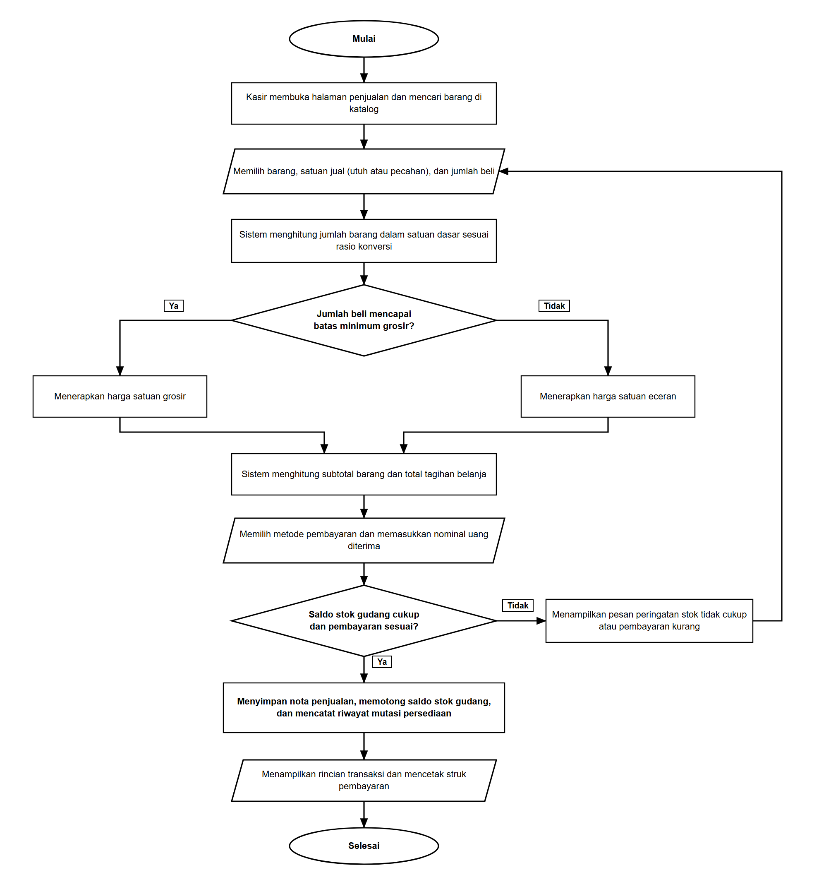
*Gambar 4.2 Flowchart Proses Transaksi Penjualan Kasir pada Sistem Usulan*

Pada Gambar 4.2 terlihat bahwa setiap barang yang dimasukkan ke dalam daftar belanja terlebih dahulu dikonversi ke satuan dasar penyimpanan, kemudian diperiksa apakah jumlah pembeliannya telah mencapai batas minimum harga grosir untuk menentukan penerapan harga grosir atau harga eceran. Selanjutnya, alur pencatatan barang masuk dari pemasok hingga pembentukan dan pelunasan hutang usaha ditunjukkan pada Gambar 4.3.

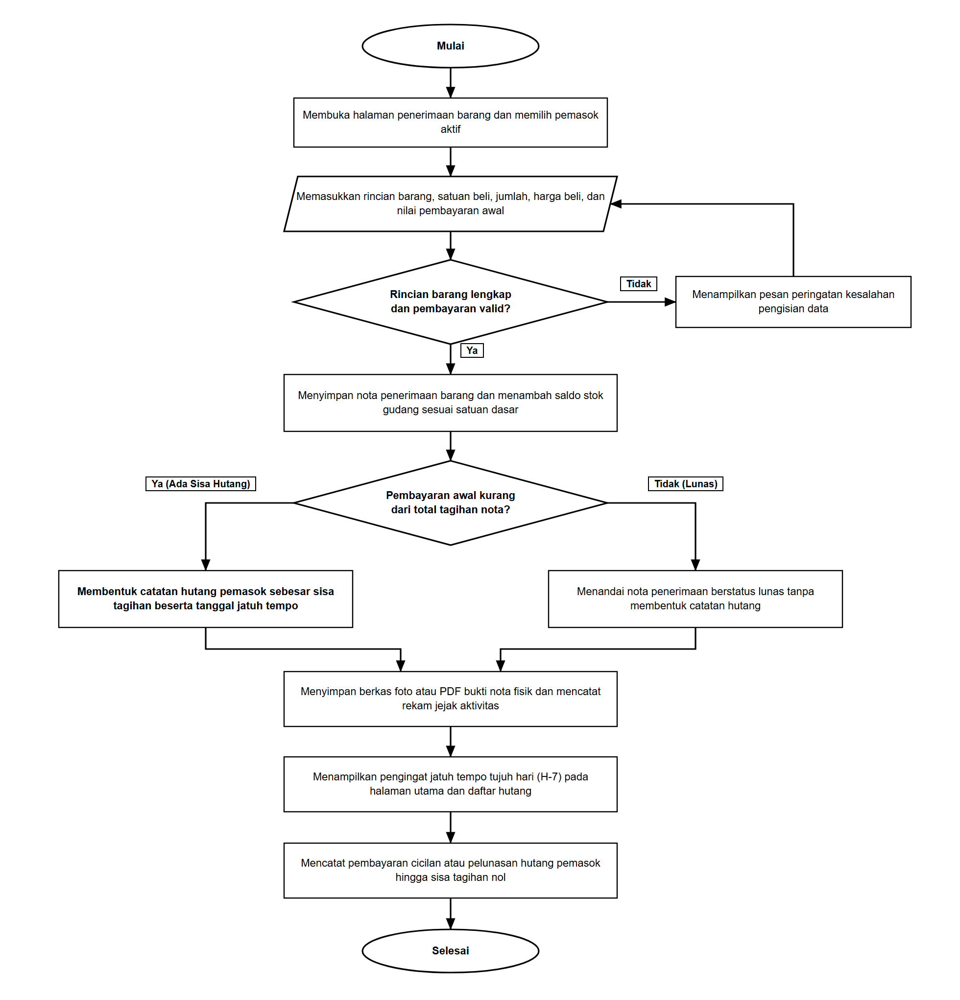
*Gambar 4.3 Flowchart Proses Penerimaan Barang dan Pengelolaan Hutang Pemasok*

Sebagaimana digambarkan pada Gambar 4.3, percabangan utama terjadi setelah penerimaan barang berhasil menambah saldo stok di gudang. Apabila nilai pembayaran awal sama dengan nilai total tagihan nota, maka penerimaan barang langsung ditandai lunas tanpa membentuk catatan hutang. Sebaliknya, apabila nilai pembayaran awal kurang dari nilai total tagihan nota, sistem otomatis membentuk catatan hutang pemasok beserta tanggal jatuh tempo yang memicu peringatan tujuh hari sebelumnya (H-7) pada halaman utama.

Untuk memisahkan tanggung jawab antara tindakan pengguna, pengolahan logika pada sistem aplikasi, dan penyimpanan pada basis data, disusun *Activity Diagram* menggunakan tiga lajur (*swimlane*). Gambar 4.4 menampilkan *Activity Diagram* untuk proses transaksi penjualan kasir.

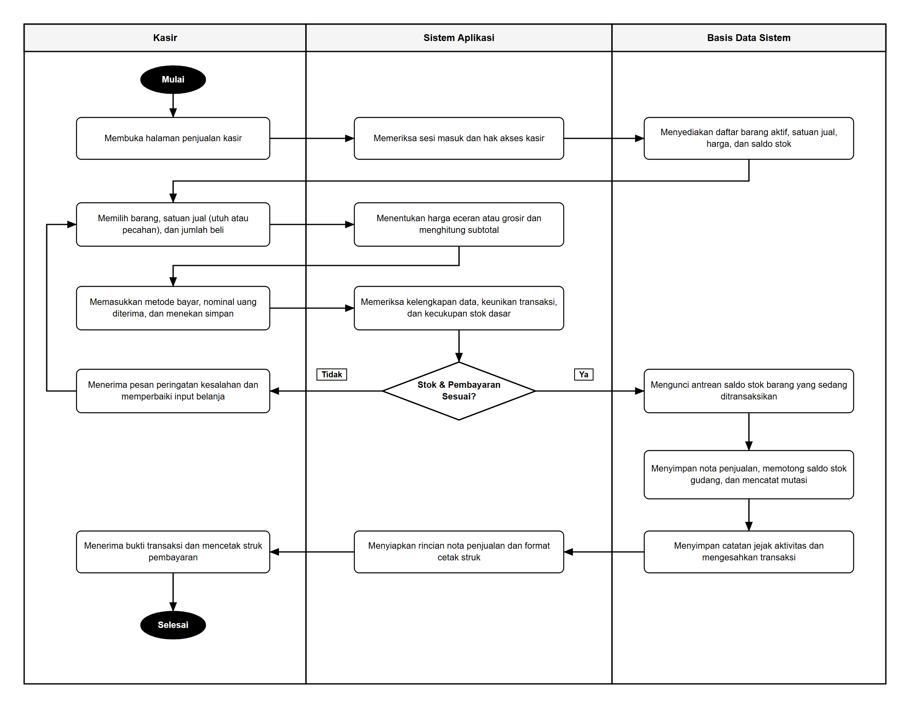
*Gambar 4.4 Activity Diagram Proses Transaksi Penjualan Kasir*

Pada Gambar 4.4, lajur tengah (*Sistem Aplikasi*) menangani penentuan harga eceran atau grosir, pemeriksaan keunikan transaksi, serta validasi kecukupan stok sebelum meminta lajur kanan (*Basis Data Sistem*) mengunci antrean saldo stok dan menyimpan transaksi penjualan secara utuh. Apabila stok tidak mencukupi atau pembayaran kurang, alur dikembalikan ke lajur kiri (*Kasir*) untuk diperbaiki. Dengan pola serupa, pembagian aktivitas antara pengguna, sistem aplikasi, dan basis data pada proses penerimaan barang serta pelunasan hutang pemasok ditunjukkan pada Gambar 4.5.

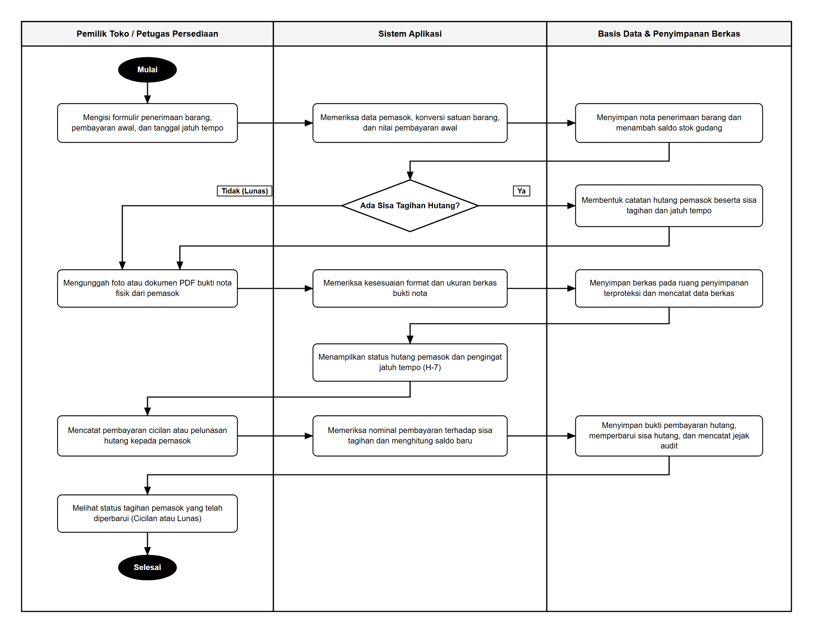
*Gambar 4.5 Activity Diagram Proses Penerimaan Barang dan Pelunasan Hutang Pemasok*

Gambar 4.5 memperlihatkan bahwa setelah barang masuk dicatat dan status hutang ditentukan, pengunggahan berkas bukti nota fisik diproses melalui pemeriksaan kesesuaian format dan ukuran berkas pada lajur tengah sebelum disimpan ke ruang penyimpanan terproteksi pada lajur kanan.

Urutan pertukaran pesan antar-bagian sistem secara kronologis saat memproses transaksi dipetakan menggunakan *Sequence Diagram*. Gambar 4.6 menjelaskan urutan pesan sejak kasir mengirimkan rincian belanja pada halaman kasir hingga transaksi penjualan selesai disimpan dan struk ditampilkan.

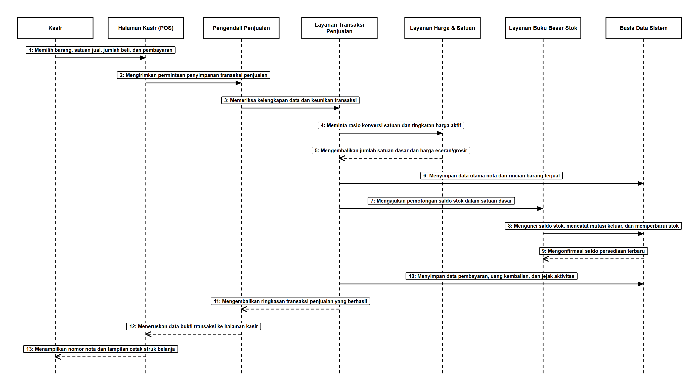
*Gambar 4.6 Sequence Diagram Proses Transaksi Penjualan Kasir*

Sebagaimana tampak pada Gambar 4.6, layanan transaksi penjualan tidak langsung menulis data secara terpisah, melainkan memeriksa rasio konversi satuan dan tingkatan harga terlebih dahulu, menyimpan nota utama, berkoordinasi dengan layanan buku besar stok untuk mengunci dan memotong saldo persediaan di gudang, lalu mencatat pembayaran beserta rekam jejak aktivitas sebelum mengembalikan bukti transaksi ke layar kasir. Selanjutnya, urutan interaksi komponen pada proses penerimaan barang dan pembayaran hutang pemasok disajikan pada Gambar 4.7.

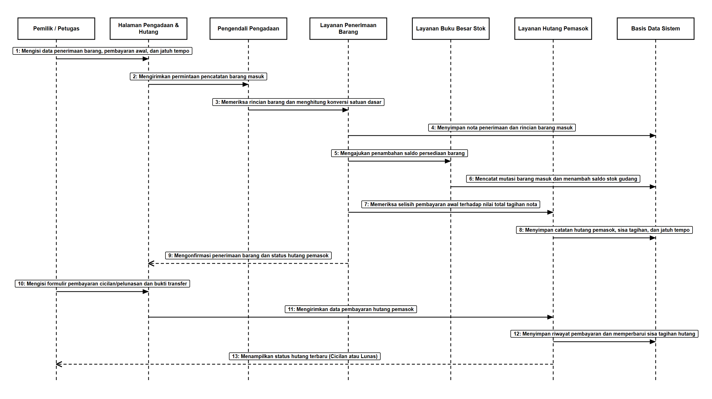
*Gambar 4.7 Sequence Diagram Proses Penerimaan Barang dan Pembayaran Hutang Pemasok*

Gambar 4.7 menunjukkan bagaimana layanan penerimaan barang berkoordinasi dengan layanan buku besar stok untuk menambah saldo persediaan sekaligus meminta layanan hutang pemasok membentuk catatan tagihan baru apabila terdapat selisih antara nilai pembayaran awal dan nilai total nota. Ketika pembayaran cicilan atau pelunasan dikirimkan oleh pengguna, layanan hutang pemasok memeriksa sisa tagihan dan memperbarui status hutang di basis data hingga lunas.

Struktur statis kelas-kelas model domain beserta atribut, metode utama, dan kardinalitas relasinya dipetakan ke dalam *Class Diagram* pada Gambar 4.8.

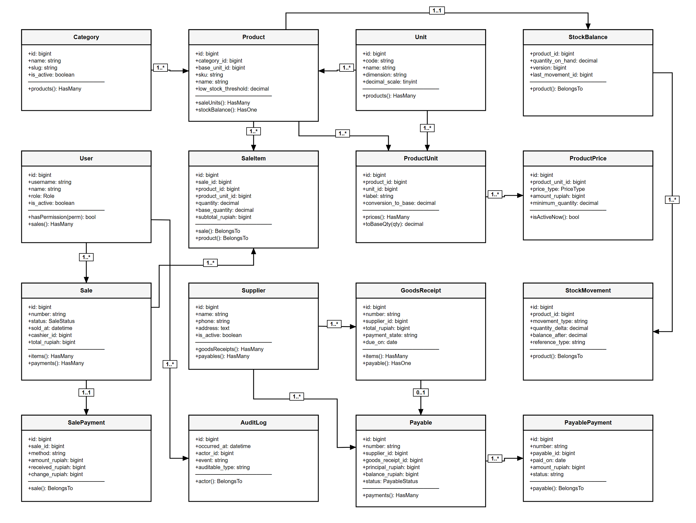
*Gambar 4.8 Class Diagram Sistem Informasi POS dan Inventaris Toko NF Harapan Rumbai*

Pada Gambar 4.8 terlihat pemisahan tanggung jawab yang jelas antara kelompok kelas katalog barang (kategori, satuan ukur, produk, satuan jual produk, dan tingkatan harga), kelompok kelas transaksi penjualan (nota penjualan, rincian barang terjual, dan pembayaran kasir), kelompok kelas buku besar persediaan (saldo stok dan riwayat mutasi stok), kelompok kelas pengadaan dan hutang pemasok (pemasok, penerimaan barang, tagihan hutang, dan cicilan pembayaran), serta kelas pendukung dokumentasi bukti transaksi dan jejak aktivitas pengguna.

#### 4.2.2.2. Perancangan Basis Data (ERD dan Spesifikasi Tabel)

Perancangan basis data relasional disusun untuk menjamin keutuhan hubungan antar-data menggunakan kunci utama (*Primary Key*), kunci penghubung (*Foreign Key*), serta penanda unik (*Unique Key*). Seluruh nilai mata uang Rupiah disimpan sebagai bilangan bulat tanpa pecahan sen untuk mencegah selisih pembulatan pada laporan keuangan, sedangkan seluruh kolom kuantitas barang disimpan menggunakan angka desimal empat digit di belakang koma agar mampu menampung transaksi takaran eceran pecahan secara presisi. Hubungan antar-entitas tabel basis data ditunjukkan pada *Entity Relationship Diagram* (ERD) di Gambar 4.9.

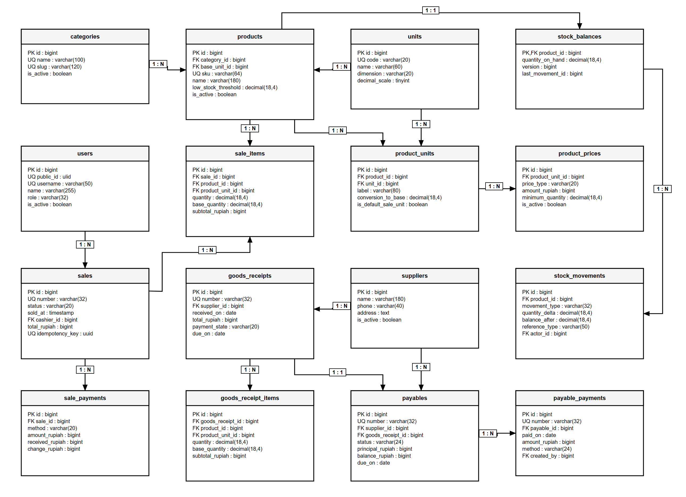
*Gambar 4.9 Entity Relationship Diagram (ERD) Basis Data Sistem Toko NF Harapan Rumbai*

Berdasarkan rancangan ERD pada Gambar 4.9, rincian struktur fisik dari dua belas kelompok tabel inti yang diterapkan pada basis data sistem diuraikan secara berurutan pada Tabel 4.9 hingga Tabel 4.20.

**Tabel 4.9 Spesifikasi Tabel Pengguna (users)**

| No. | Nama Kolom | Tipe Data & Panjang | Keterangan / Kunci |
| --- | --- | --- | --- |
| 1 | id | bigint unsigned | *Primary Key*, nomor urut otomatis |
| 2 | public_id | char(26) | *Unique*, kode identitas publik pengguna |
| 3 | username | varchar(50) | *Unique*, nama akun masuk pengguna internal |
| 4 | name | varchar(255) | Nama lengkap pengguna (pemilik atau staf toko) |
| 5 | email | varchar(255) | *Unique*, alamat surat elektronik pengguna |
| 6 | password | varchar(255) | Kata sandi akun yang telah dienkripsi satu arah |
| 7 | role | varchar(32) | Peran hak akses pengguna (Pemilik, Admin Gudang, Kasir, atau Pemeriksa) |
| 8 | is_active | boolean | Status keaktifan akun pengguna (aktif atau nonaktif) |
| 9 | force_password_change | boolean | Penanda kewajiban mengganti kata sandi saat masuk pertama kali |
| 10 | last_login_at | timestamp nullable | Catatan waktu terakhir pengguna berhasil masuk ke sistem |

**Tabel 4.10 Spesifikasi Tabel Kategori dan Satuan Ukur (categories dan units)**

| No. | Tabel | Nama Kolom | Tipe Data & Panjang | Keterangan / Kunci |
| --- | --- | --- | --- | --- |
| 1 | categories | id | bigint unsigned | *Primary Key*, nomor urut otomatis |
| 2 | categories | name | varchar(100) | *Unique*, nama kelompok kategori barang (contoh: Sembako) |
| 3 | categories | slug | varchar(120) | *Unique*, kode penanda alamat kategori |
| 4 | categories | is_active | boolean | Status keaktifan kategori barang |
| 5 | units | id | bigint unsigned | *Primary Key*, nomor urut otomatis |
| 6 | units | code | varchar(20) | *Unique*, singkatan kode satuan ukur (contoh: PCS, KG, LTR, DUS, SAK) |
| 7 | units | name | varchar(60) | Nama lengkap satuan ukur barang |
| 8 | units | dimension | varchar(20) | Jenis dimensi ukuran (hitungan buah, berat, atau volume) |
| 9 | units | decimal_scale | tinyint unsigned | Jumlah angka desimal yang ditampilkan pada layar |

**Tabel 4.11 Spesifikasi Tabel Barang Dagangan (products)**

| No. | Nama Kolom | Tipe Data & Panjang | Keterangan / Kunci |
| --- | --- | --- | --- |
| 1 | id | bigint unsigned | *Primary Key*, nomor urut otomatis |
| 2 | public_id | char(26) | *Unique*, kode identitas publik barang dagangan |
| 3 | category_id | bigint unsigned | *Foreign Key* ke tabel kategori barang |
| 4 | base_unit_id | bigint unsigned | *Foreign Key* ke tabel satuan ukur sebagai satuan dasar stok |
| 5 | sku | varchar(64) | *Unique*, kode induk barang dagangan (contoh: SMB-001) |
| 6 | barcode | varchar(64) nullable | *Unique*, nomor kode batang kemasan pabrik |
| 7 | name | varchar(180) | Nama lengkap barang dagangan |
| 8 | low_stock_threshold | decimal(18,4) | Batas minimum stok untuk memunculkan peringatan stok menipis |
| 9 | allows_negative_stock | boolean | Pengaturan izin saldo stok di bawah nol (dinonaktifkan secara bawaan) |
| 10 | is_active | boolean | Status keaktifan barang pada daftar pencarian kasir |

**Tabel 4.12 Spesifikasi Tabel Satuan Jual dan Harga Barang (product_units dan product_prices)**

| No. | Tabel | Nama Kolom | Tipe Data & Panjang | Keterangan / Kunci |
| --- | --- | --- | --- | --- |
| 1 | product_units | id | bigint unsigned | *Primary Key*, nomor urut otomatis |
| 2 | product_units | product_id | bigint unsigned | *Foreign Key* ke tabel barang dagangan |
| 3 | product_units | unit_id | bigint unsigned | *Foreign Key* ke tabel satuan ukur |
| 4 | product_units | label | varchar(80) | Nama tampilan kemasan jual (contoh: 1 kg, 1/2 kg, 1/4 kg, Karung 50 kg) |
| 5 | product_units | conversion_to_base | decimal(18,4) | Nilai pengali konversi ke satuan dasar stok (contoh: 1, 0,5, 0,25, atau 50) |
| 6 | product_units | is_default_sale_unit | boolean | Penanda satuan jual utama yang langsung terpilih di layar kasir |
| 7 | product_prices | id | bigint unsigned | *Primary Key*, nomor urut otomatis |
| 8 | product_prices | product_unit_id | bigint unsigned | *Foreign Key* ke tabel satuan jual barang |
| 9 | product_prices | price_type | varchar(20) | Kategori tingkatan harga (eceran atau grosir) |
| 10 | product_prices | amount_rupiah | bigint unsigned | Nominal harga jual per satuan kemasan dalam Rupiah |
| 11 | product_prices | minimum_quantity | decimal(18,4) | Jumlah pembelian minimum agar harga grosir diterapkan |

**Tabel 4.13 Spesifikasi Tabel Transaksi Penjualan (sales, sale_items, dan sale_payments)**

| No. | Tabel | Nama Kolom | Tipe Data & Panjang | Keterangan / Kunci |
| --- | --- | --- | --- | --- |
| 1 | sales | id | bigint unsigned | *Primary Key*, nomor urut otomatis |
| 2 | sales | number | varchar(32) | *Unique*, nomor nota penjualan kasir |
| 3 | sales | status | varchar(20) | Status nota penjualan (selesai tercatat atau dibatalkan) |
| 4 | sales | sold_at | timestamp | Tanggal dan jam terjadinya transaksi penjualan |
| 5 | sales | cashier_id | bigint unsigned | *Foreign Key* ke tabel pengguna sebagai kasir pelaksana |
| 6 | sales | total_rupiah | bigint unsigned | Total nilai tagihan belanja dalam Rupiah |
| 7 | sale_items | sale_id | bigint unsigned | *Foreign Key* ke tabel kepala nota penjualan |
| 8 | sale_items | product_unit_id | bigint unsigned | *Foreign Key* ke tabel satuan jual barang |
| 9 | sale_items | price_type | varchar(20) | Rekaman jenis harga yang berlaku saat transaksi (eceran atau grosir) |
| 10 | sale_items | quantity | decimal(18,4) | Jumlah barang yang dibeli dalam satuan jual |
| 11 | sale_items | base_quantity | decimal(18,4) | Jumlah barang setelah dikonversi ke satuan dasar stok |
| 12 | sale_items | subtotal_rupiah | bigint unsigned | Subtotal nilai baris barang dalam Rupiah |
| 13 | sale_payments | method | varchar(20) | Metode pembayaran pelanggan (tunai, transfer bank, atau QRIS) |
| 14 | sale_payments | received_rupiah | bigint unsigned | Nominal uang pembayaran yang diterima dari pelanggan |
| 15 | sale_payments | change_rupiah | bigint unsigned | Nominal uang kembalian yang diserahkan kepada pelanggan |

**Tabel 4.14 Spesifikasi Tabel Saldo dan Mutasi Stok (stock_balances dan stock_movements)**

| No. | Tabel | Nama Kolom | Tipe Data & Panjang | Keterangan / Kunci |
| --- | --- | --- | --- | --- |
| 1 | stock_balances | product_id | bigint unsigned | *Primary Key* sekaligus *Foreign Key* ke tabel barang dagangan |
| 2 | stock_balances | quantity_on_hand | decimal(18,4) | Jumlah saldo persediaan terkini dalam satuan dasar |
| 3 | stock_balances | version | bigint unsigned | Nomor urutan versi pembaruan untuk menjaga konsistensi stok |
| 4 | stock_balances | last_movement_id | bigint unsigned | Penunjuk ke catatan mutasi terakhir yang mengubah saldo |
| 5 | stock_movements | id | bigint unsigned | *Primary Key*, nomor urut otomatis |
| 6 | stock_movements | product_id | bigint unsigned | *Foreign Key* ke tabel barang dagangan |
| 7 | stock_movements | movement_type | varchar(32) | Jenis mutasi stok (penjualan keluar, penerimaan masuk, koreksi fisik, atau pembatalan nota) |
| 8 | stock_movements | quantity_delta | decimal(18,4) | Besaran perubahan jumlah stok dasar (bertambah atau berkurang) |
| 9 | stock_movements | balance_after | decimal(18,4) | Saldo persediaan dasar tepat setelah mutasi dicatat |
| 10 | stock_movements | reference_type | varchar(50) | Jenis dokumen transaksi sumber mutasi stok |
| 11 | stock_movements | actor_id | bigint unsigned | *Foreign Key* ke tabel pengguna sebagai petugas pelaksana |

**Tabel 4.15 Spesifikasi Tabel Penyesuaian Stok Fisik (stock_adjustments dan stock_adjustment_items)**

| No. | Tabel | Nama Kolom | Tipe Data & Panjang | Keterangan / Kunci |
| --- | --- | --- | --- | --- |
| 1 | stock_adjustments | id | bigint unsigned | *Primary Key*, nomor urut otomatis |
| 2 | stock_adjustments | number | varchar(32) | *Unique*, nomor dokumen berita acara penyesuaian stok |
| 3 | stock_adjustments | status | varchar(20) | Status pengesahan dokumen penyesuaian stok |
| 4 | stock_adjustments | adjusted_at | timestamp | Tanggal dan waktu pelaksanaan pemeriksaan fisik stok |
| 5 | stock_adjustments | reason_code | varchar(40) | Kategori alasan koreksi (hitung ulang rutin, rusak, susut, atau kedaluwarsa) |
| 6 | stock_adjustments | notes | text | Uraian keterangan penyebab terjadinya selisih stok fisik |
| 7 | stock_adjustment_items | stock_adjustment_id | bigint unsigned | *Foreign Key* ke tabel kepala penyesuaian stok |
| 8 | stock_adjustment_items | product_id | bigint unsigned | *Foreign Key* ke tabel barang dagangan |
| 9 | stock_adjustment_items | system_quantity | decimal(18,4) | Jumlah stok menurut catatan sistem sebelum dikoreksi |
| 10 | stock_adjustment_items | physical_quantity | decimal(18,4) | Jumlah stok nyata hasil perhitungan fisik di gudang atau etalase |
| 11 | stock_adjustment_items | delta_quantity | decimal(18,4) | Nilai selisih antara jumlah stok fisik dan jumlah stok tercatat di sistem |

**Tabel 4.16 Spesifikasi Tabel Pemasok Barang (suppliers)**

| No. | Nama Kolom | Tipe Data & Panjang | Keterangan / Kunci |
| --- | --- | --- | --- |
| 1 | id | bigint unsigned | *Primary Key*, nomor urut otomatis |
| 2 | public_id | char(26) | *Unique*, kode identitas publik pemasok |
| 3 | name | varchar(180) | Nama perusahaan distributor atau agen pemasok barang |
| 4 | contact_name | varchar(120) nullable | Nama petugas pengirim atau perwakilan penjualan pemasok |
| 5 | phone | varchar(40) nullable | Nomor telepon atau kontak pesan singkat pemasok |
| 6 | address | text nullable | Alamat lengkap kantor atau gudang pemasok |
| 7 | notes | text nullable | Catatan jenis barang pasokan atau jadwal kunjungan pengiriman |
| 8 | is_active | boolean | Status keaktifan kerja sama pemasok (aktif atau nonaktif) |

**Tabel 4.17 Spesifikasi Tabel Penerimaan Barang (goods_receipts dan goods_receipt_items)**

| No. | Tabel | Nama Kolom | Tipe Data & Panjang | Keterangan / Kunci |
| --- | --- | --- | --- | --- |
| 1 | goods_receipts | id | bigint unsigned | *Primary Key*, nomor urut otomatis |
| 2 | goods_receipts | number | varchar(32) | *Unique*, nomor bukti penerimaan barang masuk |
| 3 | goods_receipts | supplier_id | bigint unsigned | *Foreign Key* ke tabel pemasok barang |
| 4 | goods_receipts | supplier_document_number | varchar(120) nullable | Nomor faktur atau surat jalan asli dari pemasok |
| 5 | goods_receipts | received_on | date | Tanggal barang tiba dan diterima di toko |
| 6 | goods_receipts | total_rupiah | bigint unsigned | Total nilai pembelian barang pada nota dalam Rupiah |
| 7 | goods_receipts | payment_state | varchar(20) | Status pelunasan saat barang diterima (lunas, dibayar sebagian, atau belum dibayar) |
| 8 | goods_receipts | initial_payment_rupiah | bigint unsigned | Nominal uang muka atau pembayaran awal saat barang diterima |
| 9 | goods_receipts | due_on | date nullable | Tanggal batas jatuh tempo pelunasan sisa tagihan |
| 10 | goods_receipt_items | goods_receipt_id | bigint unsigned | *Foreign Key* ke tabel kepala penerimaan barang |
| 11 | goods_receipt_items | product_unit_id | bigint unsigned | *Foreign Key* ke tabel satuan kemasan barang |
| 12 | goods_receipt_items | quantity | decimal(18,4) | Jumlah barang yang diterima dalam satuan kemasan beli |
| 13 | goods_receipt_items | base_quantity | decimal(18,4) | Jumlah penambahan stok setelah dikonversi ke satuan dasar |
| 14 | goods_receipt_items | unit_cost_rupiah | bigint unsigned | Harga pokok pembelian per satuan kemasan dalam Rupiah |

**Tabel 4.18 Spesifikasi Tabel Hutang Pemasok dan Pembayaran (payables dan payable_payments)**

| No. | Tabel | Nama Kolom | Tipe Data & Panjang | Keterangan / Kunci |
| --- | --- | --- | --- | --- |
| 1 | payables | id | bigint unsigned | *Primary Key*, nomor urut otomatis |
| 2 | payables | number | varchar(32) | *Unique*, nomor registrasi tagihan hutang pemasok |
| 3 | payables | supplier_id | bigint unsigned | *Foreign Key* ke tabel pemasok barang |
| 4 | payables | goods_receipt_id | bigint unsigned | *Unique Foreign Key* ke tabel bukti penerimaan barang |
| 5 | payables | status | varchar(24) | Status penyelesaian hutang (belum dibayar, dicicil sebagian, lunas, atau dibatalkan) |
| 6 | payables | principal_rupiah | bigint unsigned | Nilai pokok tagihan hutang awal dalam Rupiah |
| 7 | payables | paid_rupiah | bigint unsigned | Total akumulasi pembayaran cicilan yang telah disetorkan |
| 8 | payables | balance_rupiah | bigint unsigned | Sisa saldo hutang yang masih harus dilunasi dalam Rupiah |
| 9 | payables | due_on | date | Tanggal jatuh tempo pelunasan hutang kepada pemasok |
| 10 | payable_payments | number | varchar(32) | *Unique*, nomor bukti transaksi pembayaran hutang |
| 11 | payable_payments | payable_id | bigint unsigned | *Foreign Key* ke tabel tagihan hutang pemasok |
| 12 | payable_payments | paid_on | date | Tanggal pelaksanaan pembayaran cicilan atau pelunasan |
| 13 | payable_payments | amount_rupiah | bigint unsigned | Nominal uang yang dibayarkan kepada pemasok dalam Rupiah |
| 14 | payable_payments | method | varchar(24) | Metode penyerahan uang (tunai atau transfer rekening bank) |

**Tabel 4.19 Spesifikasi Tabel Lampiran Dokumen Bukti (documents)**

| No. | Nama Kolom | Tipe Data & Panjang | Keterangan / Kunci |
| --- | --- | --- | --- |
| 1 | id | bigint unsigned | *Primary Key*, nomor urut otomatis |
| 2 | public_id | char(26) | *Unique*, kode identitas publik untuk pengunduhan berkas bukti |
| 3 | attachable_type | varchar(80) | Jenis transaksi pemilik lampiran (Penerimaan Barang atau Pembayaran Hutang) |
| 4 | attachable_id | bigint unsigned | Nomor identitas transaksi pemilik lampiran |
| 5 | category | varchar(50) | Kategori dokumen lampiran (foto nota pemasok atau bukti pembayaran hutang) |
| 6 | original_name | varchar(255) | Nama berkas asli saat diunggah oleh pengguna |
| 7 | storage_disk | varchar(40) | Nama media ruang penyimpanan internal yang tertutup dari akses publik |
| 8 | storage_path | varchar(255) | Lokasi penyimpanan berkas di dalam ruang internal server |
| 9 | detected_mime | varchar(80) | Format berkas yang terverifikasi (gambar JPEG, PNG, atau dokumen PDF) |
| 10 | size_bytes | bigint unsigned | Ukuran kapasitas berkas dalam satuan *byte* |
| 11 | sha256 | char(64) | Kode sidik jari digital untuk menjamin keaslian berkas lampiran |

**Tabel 4.20 Spesifikasi Tabel Jejak Aktivitas dan Pencegahan Kirim Ganda (audit_logs dan idempotency_keys)**

| No. | Tabel | Nama Kolom | Tipe Data & Panjang | Keterangan / Kunci |
| --- | --- | --- | --- | --- |
| 1 | audit_logs | id | bigint unsigned | *Primary Key*, nomor urut otomatis |
| 2 | audit_logs | occurred_at | timestamp | Waktu terjadinya aktivitas pengguna di dalam sistem |
| 3 | audit_logs | actor_id | bigint unsigned nullable | *Foreign Key* ke tabel pengguna sebagai pelaku aktivitas |
| 4 | audit_logs | event | varchar(80) | Jenis aktivitas yang dilakukan (penjualan, penerimaan barang, pembayaran hutang, atau perubahan harga) |
| 5 | audit_logs | auditable_type | varchar(80) | Kelompok data yang mengalami perubahan |
| 6 | audit_logs | before_state / after_state | json nullable | Salinan rincian nilai data sebelum dan sesudah perubahan dilakukan |
| 7 | audit_logs | request_id | varchar(64) | Nomor pelacakan sesi transaksi untuk penelusuran pemeriksaan |
| 8 | idempotency_keys | key | varchar(100) | Kode unik penanda pengiriman formulir agar tidak tercatat ganda |
| 9 | idempotency_keys | operation | varchar(60) | Jenis proses transaksi yang dilindungi dari pengiriman berulang |
| 10 | idempotency_keys | request_hash | char(64) | Kode ringkasan isi formulir untuk mendeteksi pengubahan data saat pengiriman ulang |

#### 4.2.2.3. Perancangan Keluaran (Output)

Perancangan keluaran (*output*) menetapkan bentuk penyajian informasi, media tampil, serta rincian informasi yang dihasilkan oleh sistem kepada pengguna internal maupun pelanggan Toko NF Harapan Rumbai. Delapan spesifikasi keluaran utama sistem dirinci pada Tabel 4.21 hingga Tabel 4.28.

**Tabel 4.21 Rancangan Keluaran Struk Transaksi Penjualan (POS)**

| Atribut Rancangan Keluaran | Spesifikasi Keluaran |
| --- | --- |
| Nama Keluaran | Struk Transaksi Penjualan Kasir (*Point of Sale*) |
| Media & Format | Tampilan Layar Web dan Cetakan Kertas Struk Kasir / Dokumen PDF |
| Sumber Data | Data profil toko, data transaksi penjualan, rincian barang terjual, pembayaran kasir, dan data petugas kasir |
| Tujuan Penerima | Pelanggan Toko NF Harapan Rumbai dan Arsip Kasir |
| Elemen Informasi Keluaran | Nama dan alamat Toko NF Harapan Rumbai, Nomor Nota Penjualan, Tanggal dan Jam Transaksi, Nama Kasir, Daftar Barang Belanjaan (Nama Barang, Satuan Jual, Jumlah Beli, Jenis Harga Eceran atau Grosir, Harga Satuan, dan Subtotal), Total Tagihan Belanja, Metode Pembayaran, Nominal Uang Diterima, serta Nominal Uang Kembalian. |

**Tabel 4.22 Rancangan Keluaran Ringkasan Dashboard dan Pengingat Jatuh Tempo**

| Atribut Rancangan Keluaran | Spesifikasi Keluaran |
| --- | --- |
| Nama Keluaran | Panel Ringkasan Operasional Toko dan Pengingat Hutang Jatuh Tempo |
| Media & Format | Layar Web Interaktif (Kartu Ringkasan Utama, Grafik Penjualan 7 Hari, dan Tabel Peringatan Dini) |
| Sumber Data | Data transaksi penjualan, penerimaan barang, tagihan hutang pemasok, saldo stok terkini, dan catatan jejak aktivitas |
| Tujuan Penerima | Pemilik Toko dan Pemeriksa Internal |
| Elemen Informasi Keluaran | Total Nilai Penjualan Hari Ini, Total Penerimaan Barang Hari Ini, Total Hutang Pemasok yang Jatuh Tempo dalam 7 Hari ke Depan, Jumlah Barang dengan Saldo Stok di Bawah Batas Minimum, Grafik Batang Penjualan 7 Hari Terakhir, serta Daftar Aktivitas Operasional Terbaru. |

**Tabel 4.23 Rancangan Keluaran Buku Besar dan Riwayat Pergerakan Stok**

| Atribut Rancangan Keluaran | Spesifikasi Keluaran |
| --- | --- |
| Nama Keluaran | Daftar Saldo Persediaan dan Riwayat Mutasi Stok Barang |
| Media & Format | Tabel Layar Web, Berkas Tabel CSV, dan Dokumen PDF Siap Cetak |
| Sumber Data | Data katalog barang, satuan ukur dasar, saldo stok terkini, riwayat mutasi stok, dan data petugas |
| Tujuan Penerima | Pemilik Toko, Admin Gudang, dan Pemeriksa Internal |
| Elemen Informasi Keluaran | Tanggal dan Jam Mutasi, Kode dan Nama Barang, Jenis Pergerakan Stok (Penjualan Kasir, Penerimaan Pemasok, Penyesuaian Fisik, atau Pembatalan Nota), Jumlah Perubahan Stok dalam Satuan Dasar, Saldo Stok Akhir Setelah Mutasi, Nomor Bukti Transaksi Sumber, serta Nama Petugas Pelaksana. |

**Tabel 4.24 Rancangan Keluaran Bukti Penerimaan Barang Pemasok**

| Atribut Rancangan Keluaran | Spesifikasi Keluaran |
| --- | --- |
| Nama Keluaran | Rincian Bukti Penerimaan Barang Masuk dari Pemasok |
| Media & Format | Layar Web dan Tautan Unduhan Lampiran Foto Nota Pemasok |
| Sumber Data | Data penerimaan barang, rincian barang masuk, data pemasok, tagihan hutang terkait, dan berkas lampiran bukti |
| Tujuan Penerima | Pemilik Toko, Admin Gudang, dan Pemeriksa Internal |
| Elemen Informasi Keluaran | Nomor Bukti Penerimaan Barang, Nama Pemasok, Nomor Faktur Asli Pemasok, Tanggal Barang Diterima, Tabel Rincian Barang Masuk (Nama Barang, Satuan Kemasan Beli, Jumlah Diterima, Hasil Konversi ke Satuan Dasar, Harga Beli Satuan, dan Subtotal), Total Nilai Pembelian, Status Pembayaran, serta Tautan ke Kartu Hutang Terkait. |

**Tabel 4.25 Rancangan Keluaran Kartu Kewajiban dan Riwayat Pembayaran Pemasok**

| Atribut Rancangan Keluaran | Spesifikasi Keluaran |
| --- | --- |
| Nama Keluaran | Kartu Rincian Hutang Pemasok dan Riwayat Pembayaran Cicilan |
| Media & Format | Layar Web, Berkas CSV/PDF, dan Unduhan Berkas Bukti Pembayaran |
| Sumber Data | Data tagihan hutang pemasok, riwayat cicilan pembayaran, data pemasok, berkas lampiran bukti bayar, dan data petugas |
| Tujuan Penerima | Pemilik Toko, Admin Gudang, dan Pemeriksa Internal |
| Elemen Informasi Keluaran | Nomor Registrasi Hutang, Nama Pemasok, Tanggal Jatuh Tempo Pelunasan, Nilai Pokok Tagihan Awal, Total Akumulasi Pembayaran yang Telah Disetorkan, Sisa Saldo Hutang yang Belum Dibayar, Tabel Riwayat Cicilan atau Pelunasan, serta Tautan Unduh Bukti Transfer atau Kwitansi. |

**Tabel 4.26 Rancangan Keluaran Laporan Penjualan Periodik**

| Atribut Rancangan Keluaran | Spesifikasi Keluaran |
| --- | --- |
| Nama Keluaran | Laporan Rekapitulasi Penjualan Periodik |
| Media & Format | Tabel Layar Web, Berkas CSV untuk Olah Data, dan Dokumen PDF Siap Cetak |
| Sumber Data | Data nota penjualan, rincian barang terjual, metode pembayaran, dan data petugas kasir |
| Tujuan Penerima | Pemilik Toko dan Pemeriksa Internal |
| Elemen Informasi Keluaran | Rentang Tanggal Laporan, Jumlah Transaksi Penjualan Selesai, Total Pendapatan Penjualan, serta Tabel Rincian per Nota (Nomor Nota Penjualan, Waktu Transaksi, Nama Kasir, Jumlah Jenis Barang, Metode Pembayaran, Status Nota, dan Total Nilai Belanja). |

**Tabel 4.27 Rancangan Keluaran Laporan Pembelian dan Kewajiban Pemasok**

| Atribut Rancangan Keluaran | Spesifikasi Keluaran |
| --- | --- |
| Nama Keluaran | Laporan Pembelian Barang dan Daftar Umur Hutang Pemasok |
| Media & Format | Tabel Layar Web, Berkas CSV, dan Dokumen PDF Siap Cetak |
| Sumber Data | Data penerimaan barang, tagihan hutang pemasok, riwayat pembayaran cicilan, dan data pemasok |
| Tujuan Penerima | Pemilik Toko dan Pemeriksa Internal |
| Elemen Informasi Keluaran | Daftar Penerimaan Barang dan Tagihan Hutang per Pemasok, Tanggal Terima Barang, Tanggal Jatuh Tempo, Kategori Status Jatuh Tempo (Aman, Mendekati Jatuh Tempo 7 Hari, atau Melewati Jatuh Tempo), Nilai Pokok Tagihan, Total Sudah Dibayar, serta Total Sisa Hutang Aktif. |

**Tabel 4.28 Rancangan Keluaran Jejak Aktivitas Sistem**

| Atribut Rancangan Keluaran | Spesifikasi Keluaran |
| --- | --- |
| Nama Keluaran | Daftar Jejak Aktivitas Pengguna (*Audit Trail*) |
| Media & Format | Tabel Layar Web dengan Penyaring Pencarian Aktivitas dan Rentang Waktu |
| Sumber Data | Data catatan jejak aktivitas sistem dan data pengguna internal |
| Tujuan Penerima | Pemilik Toko dan Pemeriksa Internal |
| Elemen Informasi Keluaran | Tanggal dan Jam Kejadian, Jenis Aktivitas Operasional, Kelompok Data dan Nomor Dokumen yang Mengalami Perubahan, Nama Pengguna Pelaku, Alamat Jaringan Perangkat, serta Ringkasan Perbandingan Nilai Data Sebelum dan Sesudah Perubahan. |

#### 4.2.2.4. Perancangan Masukan dan Antarmuka (Wireframe)

Sebelum antarmuka aplikasi dibangun menjadi halaman web yang utuh, terlebih dahulu disusun rancangan tata letak layar (*wireframe*) hitam-putih untuk memastikan setiap kolom isian dan tombol aksi mudah dijangkau oleh petugas toko. Seluruh halaman operasional menggunakan struktur bilah navigasi samping di sisi kiri dan ruang kerja utama di sisi kanan, kecuali halaman masuk pengguna yang dirancang terpusat di tengah layar.

Rancangan *wireframe* halaman Masuk Pengguna pada Gambar 4.10 memuat kolom isian nama pengguna atau surat elektronik, kolom kata sandi, pilihan pengingat sesi masuk, tombol masuk ke sistem, serta kotak pesan peringatan apabila kata sandi yang dimasukkan salah atau akun sedang dinonaktifkan.

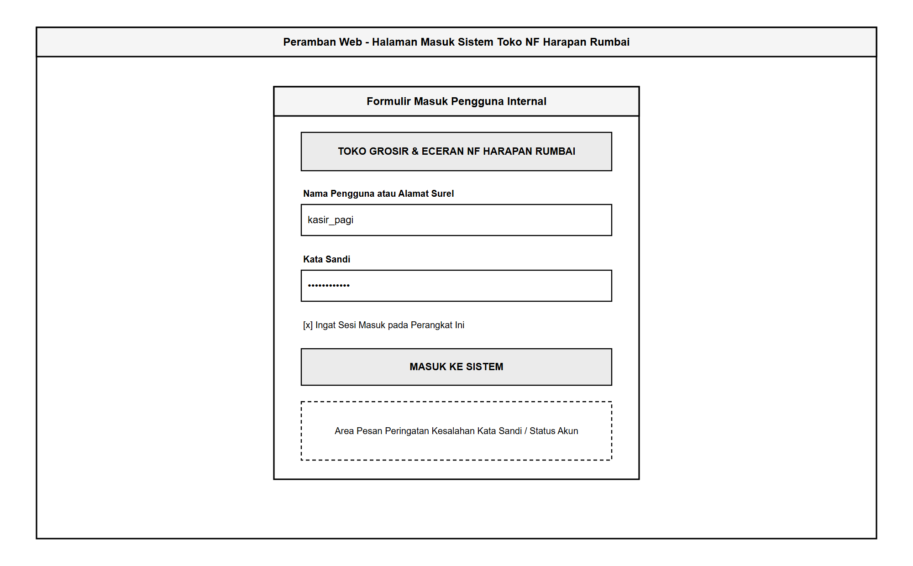
*Gambar 4.10 Wireframe Rancangan Antarmuka Halaman Masuk (Login)*

Setelah pengguna berhasil masuk sebagai Pemilik Toko, sistem menampilkan halaman Ringkasan Operasional (*Dashboard*) sebagaimana dirancang pada Gambar 4.11. Bagian atas halaman menyajikan empat kartu indikator utama (Penjualan Hari Ini, Penerimaan Barang Hari Ini, Hutang Jatuh Tempo 7 Hari ke Depan, dan Barang dengan Stok Menipis), diikuti grafik tren penjualan mingguan, tabel peringatan hutang pemasok yang mendekati jatuh tempo, serta tabel daftar barang yang perlu segera dipesan kembali.

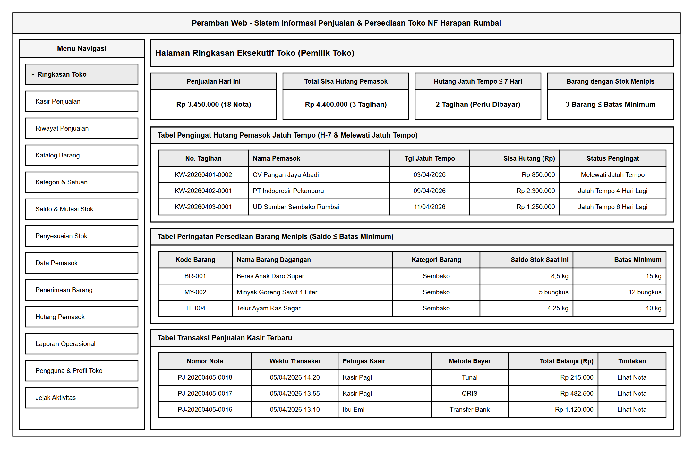
*Gambar 4.11 Wireframe Rancangan Antarmuka Halaman Dashboard Pemilik*

Untuk mengakomodasi aturan penjualan multi-satuan dan harga bertingkat di Toko NF Harapan Rumbai, rancangan formulir pengelolaan barang pada Gambar 4.12 dibagi menjadi tiga bagian berurutan: bagian identitas barang beserta satuan dasar stok dan batas pengingat stok menipis, bagian tabel daftar satuan kemasan jual beserta nilai pengali konversinya terhadap satuan dasar (seperti kemasan karung 50 kilogram, eceran 1 kilogram, setengah kilogram, dan seperempat kilogram), serta bagian tabel aturan harga eceran dan harga grosir lengkap dengan syarat jumlah pembelian minimum.

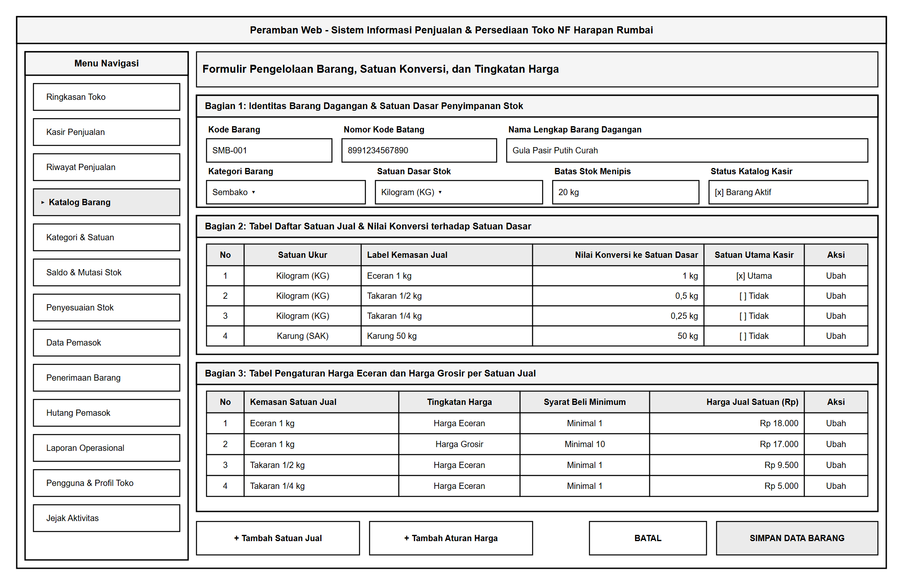
*Gambar 4.12 Wireframe Rancangan Antarmuka Form Produk, Multi-Satuan Konversi, dan Harga Bertingkat*

Rancangan halaman Kasir Penjualan (*Point of Sale*) pada Gambar 4.13 menempatkan bilah pencarian barang, pilihan satuan jual, dan tabel rincian keranjang belanja di panel kiri, sedangkan ringkasan total tagihan, pilihan metode pembayaran (tunai, transfer bank, atau QRIS), kolom nominal uang diterima, perhitungan uang kembalian otomatis, dan tombol penyelesaian transaksi ditempatkan pada panel kanan agar kasir dapat melayani pembeli secara cepat dalam satu tampilan layar.

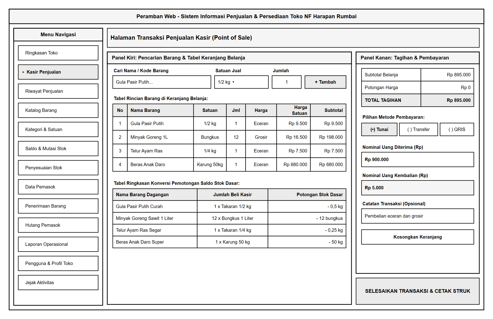
*Gambar 4.13 Wireframe Rancangan Antarmuka Halaman Kasir Point of Sale (POS)*

Selanjutnya, rancangan formulir pencatatan penerimaan barang dari pemasok ditunjukkan pada Gambar 4.14. Formulir ini menggabungkan isian informasi nota pemasok di bagian atas, tabel daftar barang yang diterima beserta kemasan beli dan harga belinya di bagian tengah, serta panel pengaturan pembayaran awal, tanggal jatuh tempo pelunasan apabila terdapat sisa tagihan, dan fitur unggah foto bukti nota pemasok di bagian bawah.

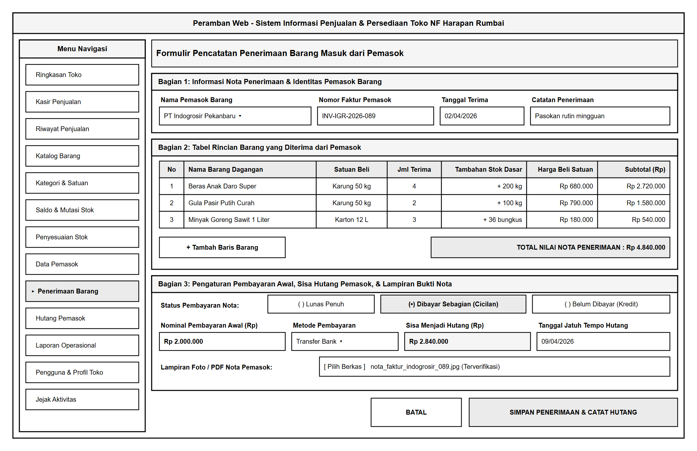
*Gambar 4.14 Wireframe Rancangan Antarmuka Form Pencatatan Penerimaan Barang Pemasok*

Untuk memantau dan melunasi hutang dagang yang timbul dari penerimaan barang secara kredit atau bayar sebagian, dirancang halaman rincian hutang pemasok dan formulir pencatatan pembayaran sebagaimana tampak pada Gambar 4.15. Halaman ini menampilkan ringkasan nilai pokok tagihan, akumulasi pembayaran yang telah disetor, sisa saldo hutang, tabel riwayat cicilan, serta formulir pengisian pembayaran baru yang dilengkapi fitur unggah bukti transfer atau kwitansi.

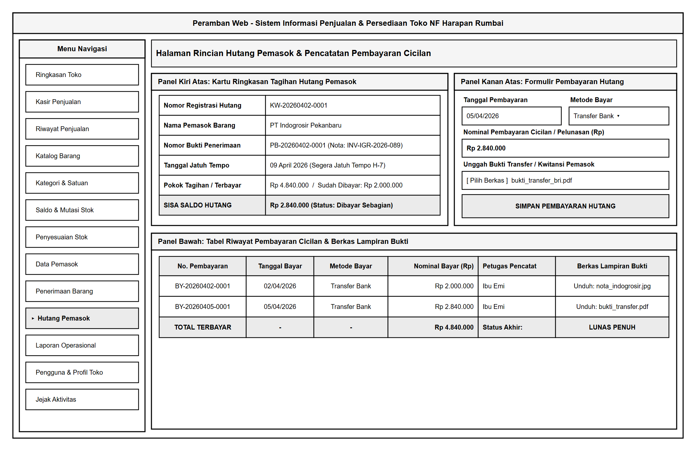
*Gambar 4.15 Wireframe Rancangan Antarmuka Halaman Detail Kewajiban dan Pencatatan Pembayaran*

Rancangan formulir penyesuaian stok fisik (*stock opname*) pada Gambar 4.16 disediakan khusus bagi Pemilik Toko untuk mencatat hasil perhitungan fisik barang di gudang atau rak toko, memilih kategori alasan koreksi, melihat selisih otomatis terhadap stok sistem, serta mencantumkan keterangan penyebab selisih sebelum disimpan ke buku besar persediaan.

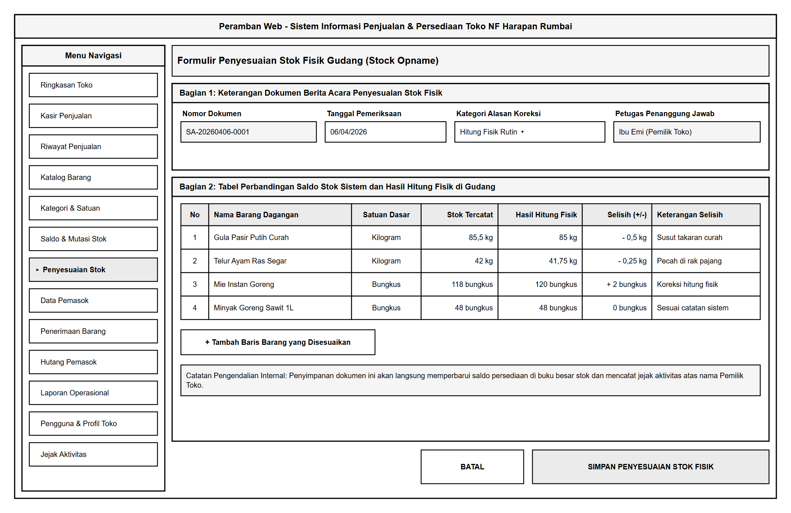
*Gambar 4.16 Wireframe Rancangan Antarmuka Form Penyesuaian Stok Fisik (Stock Opname)*

Adapun rancangan halaman laporan operasional dan ekspor dokumen pada Gambar 4.17 menyediakan pilihan jenis laporan (Laporan Penjualan, Pergerakan Stok, Penerimaan Barang, dan Hutang Pemasok), penyaring rentang tanggal, kartu ringkasan capaian, tombol unduh berkas CSV dan cetak PDF, serta tabel rincian transaksi.

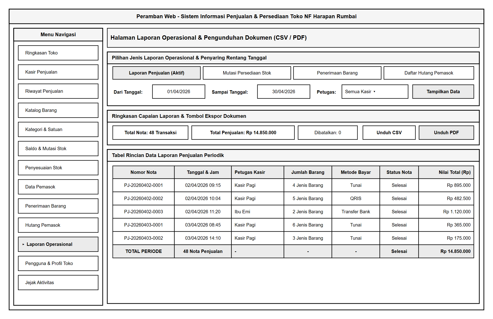
*Gambar 4.17 Wireframe Rancangan Antarmuka Halaman Laporan Operasional dan Ekspor Dokumen*

### 4.2.3. Implementasi Sistem

Tahap implementasi sistem merupakan proses perwujudan rancangan proses bisnis, struktur basis data, serta tata letak antarmuka (*wireframe*) menjadi aplikasi web yang siap digunakan dalam kegiatan operasional Toko NF Harapan Rumbai. Aplikasi dibangun menggunakan kerangka kerja aplikasi web berbasis PHP dengan tampilan antarmuka yang responsif serta manajemen basis data relasional MySQL.

#### 4.2.3.1. Lingkungan Implementasi Perangkat Keras dan Perangkat Lunak

Pembangunan dan pengujian sistem dilakukan pada perangkat komputer yang merepresentasikan sarana kerja kasir dan pemilik di Toko NF Harapan Rumbai. Spesifikasi perangkat keras dan perangkat lunak yang digunakan pada tahap implementasi dirinci pada Tabel 4.29.

**Tabel 4.29 Spesifikasi Lingkungan Perangkat Keras dan Perangkat Lunak Implementasi**

| No. | Kategori | Komponen / Perangkat | Spesifikasi yang Digunakan |
| --- | --- | --- | --- |
| 1 | Perangkat Keras | Prosesor (*CPU*) | Prosesor Multi-Inti 64-bit |
| 2 | Perangkat Keras | Memori Utama (*RAM*) | 16 GB DDR4 / DDR5 |
| 3 | Perangkat Keras | Media Penyimpanan | Solid State Drive (SSD) NVMe |
| 4 | Perangkat Keras | Perangkat Tampilan | Monitor Resolusi Full HD (1920 x 1080 piksel) |
| 5 | Perangkat Lunak | Sistem Operasi | Microsoft Windows 11 64-bit |
| 6 | Perangkat Lunak | Lingkungan Server Lokal | Laravel Herd (Web Server Nginx & PHP 8.4) |
| 7 | Perangkat Lunak | Kerangka Kerja Aplikasi | Laravel Framework 12, Livewire 4, dan Flux UI 2 |
| 8 | Perangkat Lunak | Penataan Antarmuka Web | Tailwind CSS 4, Alpine.js, dan Vite |
| 9 | Perangkat Lunak | Manajemen Basis Data | MySQL 8 (Basis Data Operasional Toko) |
| 10 | Perangkat Lunak | Perangkat Pengujian | Pengujian Fungsional Black Box & Pest PHP |
| 11 | Perangkat Lunak | Peramban Web (*Browser*) | Google Chrome Desktop |

Lingkungan perangkat lunak pada Tabel 4.29 dipilih karena kemampuannya memproses perhitungan harga dan konversi stok secara terpusat di sisi server sekaligus menyajikan perpindahan halaman yang ringan pada komputer kasir.

#### 4.2.3.2. Implementasi Antarmuka Sistem

Hasil implementasi antarmuka aplikasi disajikan secara berurutan mulai dari halaman masuk pengguna, ringkasan operasional (*dashboard*) berdasarkan peran, pengelolaan katalog barang dan satuan konversi, transaksi kasir *Point of Sale* (POS), buku besar persediaan, penerimaan barang dan hutang pemasok, hingga laporan operasional dan jejak aktivitas pengguna.

1. **Halaman Masuk Pengguna (*Login*)**: Halaman pertama yang ditampilkan saat pengguna membuka sistem adalah halaman masuk pengguna. Pengguna cukup mengisi nama pengguna atau alamat surel beserta kata sandi internal yang telah didaftarkan oleh pemilik toko. Tampilan hasil implementasi halaman masuk pengguna ditunjukkan pada Gambar 4.18.

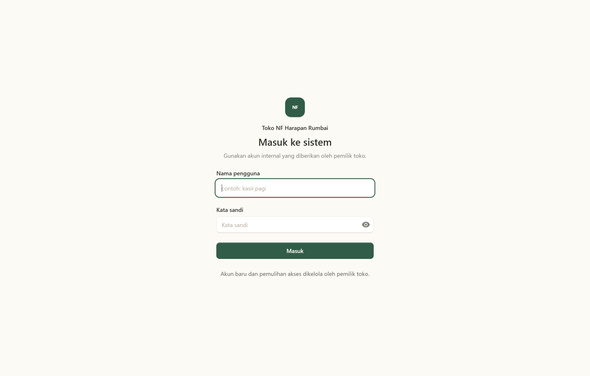
*Gambar 4.18 Implementasi Antarmuka Halaman Masuk (Login)*

Sebagaimana terlihat pada Gambar 4.18, halaman masuk dirancang sederhana dan tertutup tanpa formulir pendaftaran mandiri karena sistem ini khusus digunakan oleh personel internal Toko NF Harapan Rumbai.

2. **Halaman Ringkasan Operasional Pemilik Toko (*Dashboard Owner*)**: Ketika pengguna masuk menggunakan akun Pemilik Toko (Ibu Emi Erawati), sistem menampilkan halaman ringkasan eksekutif toko sebagaimana disajikan pada Gambar 4.19.

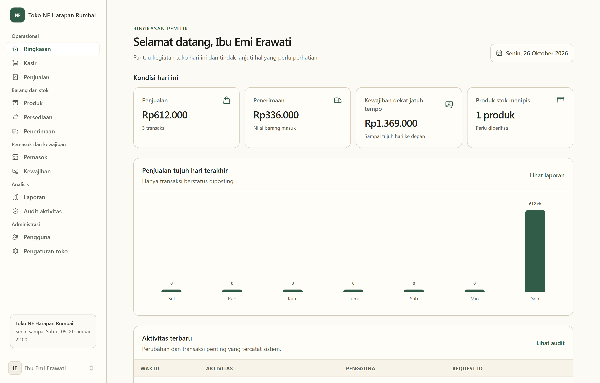
*Gambar 4.19 Implementasi Antarmuka Halaman Dashboard Pemilik (Owner)*

Pada Gambar 4.19 terlihat empat kartu indikator kondisi toko hari ini, yaitu nilai penjualan hari ini sebesar Rp612.000 dari 3 transaksi, nilai penerimaan barang masuk sebesar Rp336.000, total hutang pemasok yang mendekati jatuh tempo hingga tujuh hari ke depan sebesar Rp1.369.000, serta peringatan barang dengan stok menipis sebanyak 1 barang. Di bagian bawahnya disajikan grafik penjualan tujuh hari terakhir serta daftar aktivitas terbaru.

3. **Halaman Ringkasan Operasional Kasir**: Berbeda dengan tampilan pemilik toko, pengguna yang masuk dengan peran Kasir (Dinda Permata) hanya melihat ringkasan kerja yang berkaitan dengan pelayanan penjualan harian sebagaimana ditunjukkan pada Gambar 4.20.

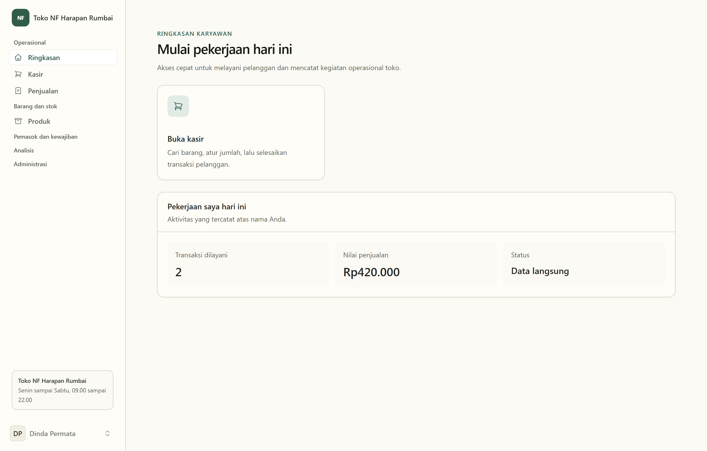
*Gambar 4.20 Implementasi Antarmuka Halaman Dashboard Staf Kasir*

Pada Gambar 4.20 tampak bahwa bilah navigasi samping untuk peran Kasir secara otomatis menyembunyikan menu pengelolaan gudang, pemasok, hutang dagang, laporan keuangan, dan pengaturan pengguna, sehingga kasir dapat langsung berfokus pada pelayanan transaksi penjualan.

4. **Halaman Pengelolaan Kategori dan Satuan Ukur Barang**: Sebelum mendaftarkan barang dagangan, pemilik toko atau admin gudang terlebih dahulu mengatur daftar kategori dan satuan ukur pada menu referensi katalog. Tampilan halaman pengelolaan satuan ukur barang ditunjukkan pada Gambar 4.21.

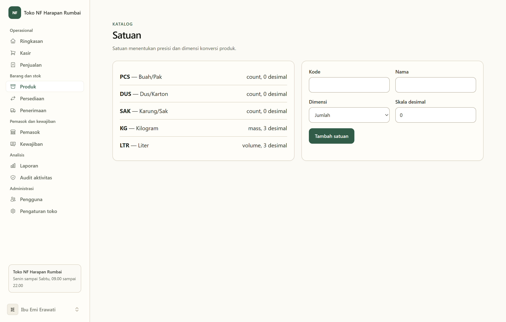
*Gambar 4.21 Implementasi Antarmuka Halaman Pengelolaan Satuan Barang*

Gambar 4.21 memperlihatkan daftar satuan ukur yang digunakan di Toko NF Harapan Rumbai, mulai dari satuan buah/bungkus, kilogram, liter, dus/karton, hingga karung/sak lengkap dengan pengaturan ketelitian angka desimalnya.

5. **Halaman Daftar Katalog Barang Dagangan**: Seluruh barang dagangan yang telah terdaftar di dalam sistem ditampilkan pada halaman daftar katalog produk sebagaimana disajikan pada Gambar 4.22.

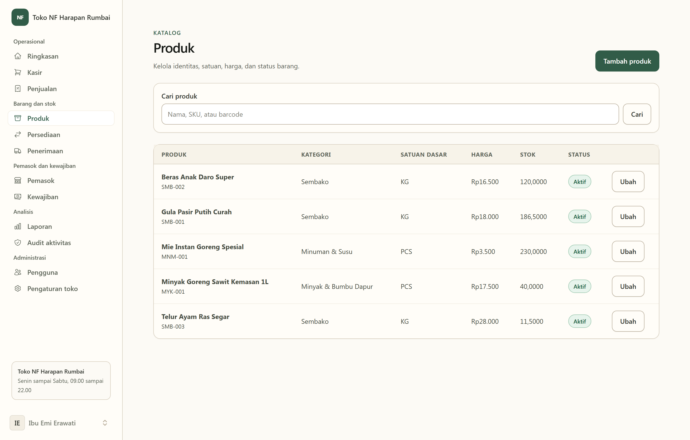
*Gambar 4.22 Implementasi Antarmuka Halaman Daftar Katalog Produk*

Pada Gambar 4.22, setiap baris barang menampilkan kode barang, nama lengkap produk, kategori, satuan dasar penyimpanan stok, jumlah saldo stok terkini, harga jual utama, serta tombol untuk memperbarui pengaturan satuan dan harga.

6. **Halaman Formulir Barang, Multi-Satuan Konversi, dan Harga Bertingkat**: Pengaturan rinci suatu barang beserta pilihan kemasan jual (seperti eceran 1 kg, takaran 1/2 kg, takaran 1/4 kg, maupun kemasan karung 50 kg) dan aturan harga eceran maupun grosir dilakukan pada halaman ubah barang sebagaimana ditampilkan pada Gambar 4.23.

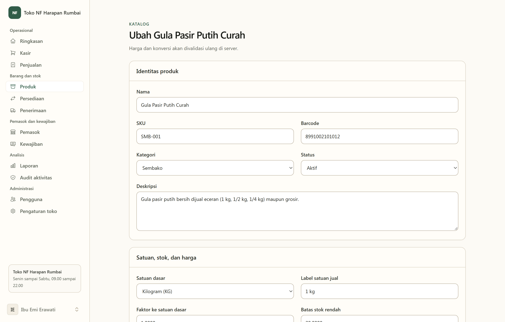
*Gambar 4.23 Implementasi Antarmuka Form Produk, Multi-Satuan Konversi, dan Harga Bertingkat*

Gambar 4.23 menunjukkan bagaimana produk Gula Pasir Putih Curah yang memiliki satuan dasar kilogram dapat dilengkapi dengan berbagai satuan jual turunan beserta rasio pengalinya terhadap satuan dasar, sekaligus menetapkan harga jual eceran dan harga jual grosir berdasarkan jumlah pembelian minimum.

7. **Halaman Kasir Penjualan (*Point of Sale*)**: Pelayanan transaksi belanja pelanggan sehari-hari dilakukan melalui halaman Kasir POS yang ditampilkan pada Gambar 4.24.

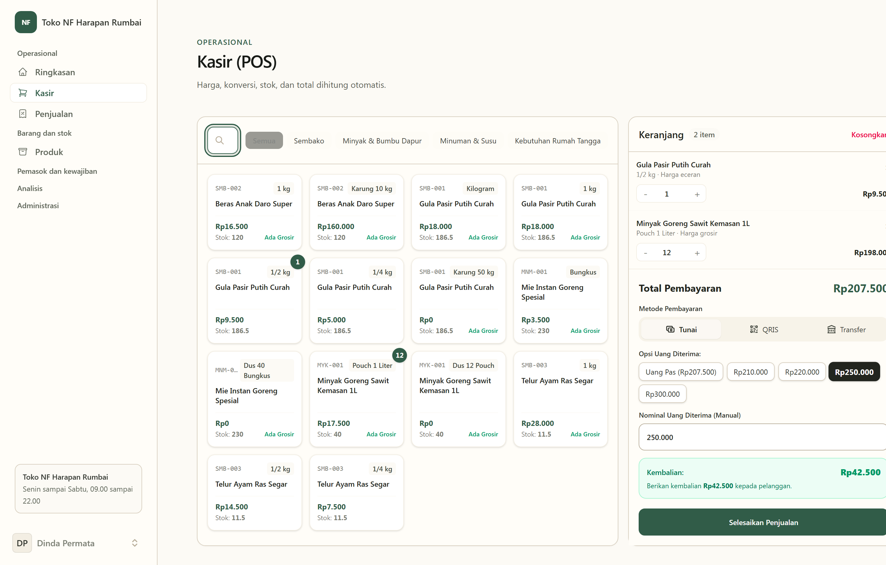
*Gambar 4.24 Implementasi Antarmuka Halaman Kasir Point of Sale (POS)*

Pada Gambar 4.24 terlihat simulasi transaksi penjualan ketika kasir melayani pembelian dua barang sekaligus, yakni Gula Pasir Putih Curah kemasan 1/2 kg sebanyak 1 bungkus yang dikenai harga eceran sebesar Rp9.500, serta Minyak Goreng Sawit Kemasan 1 Liter sebanyak 12 bungkus yang secara otomatis beralih menggunakan harga grosir sebesar Rp198.000. Panel sebelah kanan menampilkan total tagihan belanja sebesar Rp207.500, pilihan nominal uang diterima Rp250.000, serta perhitungan uang kembalian otomatis sebesar Rp42.500.

8. **Halaman Rincian Penjualan dan Cetak Struk**: Sesaat setelah kasir menekan tombol penyelesaian penjualan, sistem menyimpan transaksi dan menampilkan halaman rincian nota beserta tampilan struk sebagaimana ditunjukkan pada Gambar 4.25.

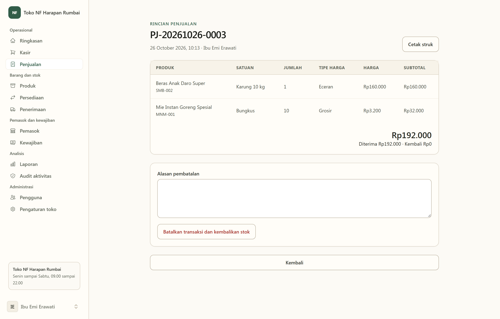
*Gambar 4.25 Implementasi Antarmuka Halaman Detail Transaksi Penjualan dan Struk*

Halaman pada Gambar 4.25 menyajikan nomor nota penjualan unik, tanggal dan jam transaksi, nama petugas kasir, rincian barang yang dibeli beserta harga dan subtotalnya, metode pembayaran, tombol cetak struk belanja, serta fitur pembatalan nota resmi khusus bagi Pemilik Toko.

9. **Halaman Saldo dan Riwayat Pergerakan Stok**: Setiap penambahan maupun pengurangan stok akibat penjualan kasir, penerimaan barang dari pemasok, maupun koreksi stok fisik tercatat secara berurutan pada halaman riwayat pergerakan stok yang ditampilkan pada Gambar 4.26.

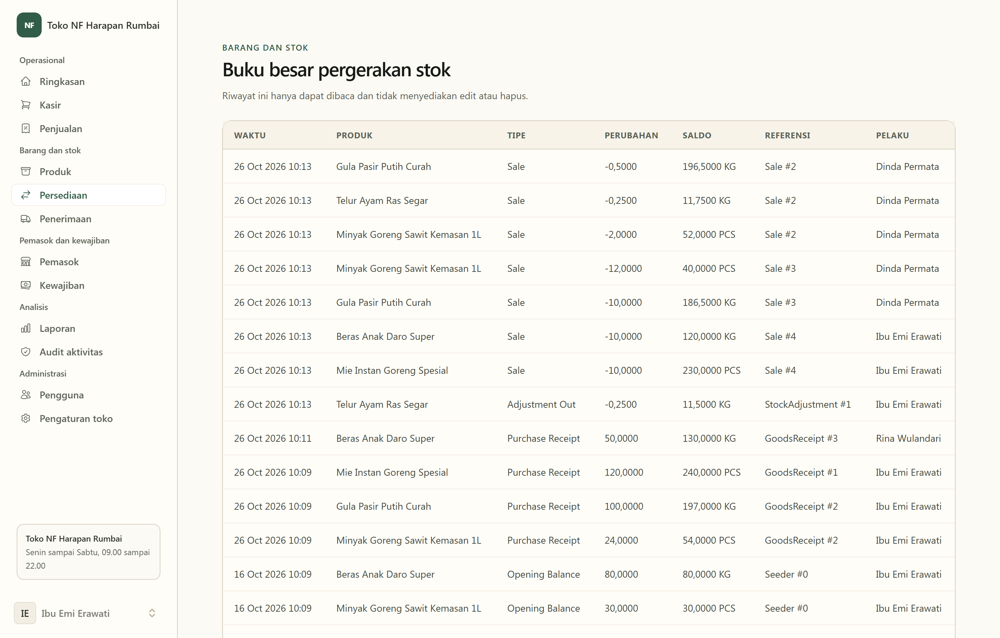
*Gambar 4.26 Implementasi Antarmuka Halaman Riwayat Pergerakan Stok (Inventory Ledger)*

Gambar 4.26 memperlihatkan bahwa penjualan gula pasir takaran 1/2 kg tercatat sebagai pengurangan stok dasar sebesar 0,5 kg dan penjualan telur ayam takaran 1/4 kg tercatat sebagai pengurangan sebesar 0,25 kg, disertai informasi saldo persediaan akhir yang terhitung secara akurat.

10. **Halaman Formulir Penyesuaian Stok Fisik (*Stock Opname*)**: Apabila ditemukan perbedaan antara jumlah stok fisik di rak toko dan jumlah stok yang tertera di sistem, Pemilik Toko dapat melakukan koreksi saldo melalui halaman penyesuaian stok fisik pada Gambar 4.27.

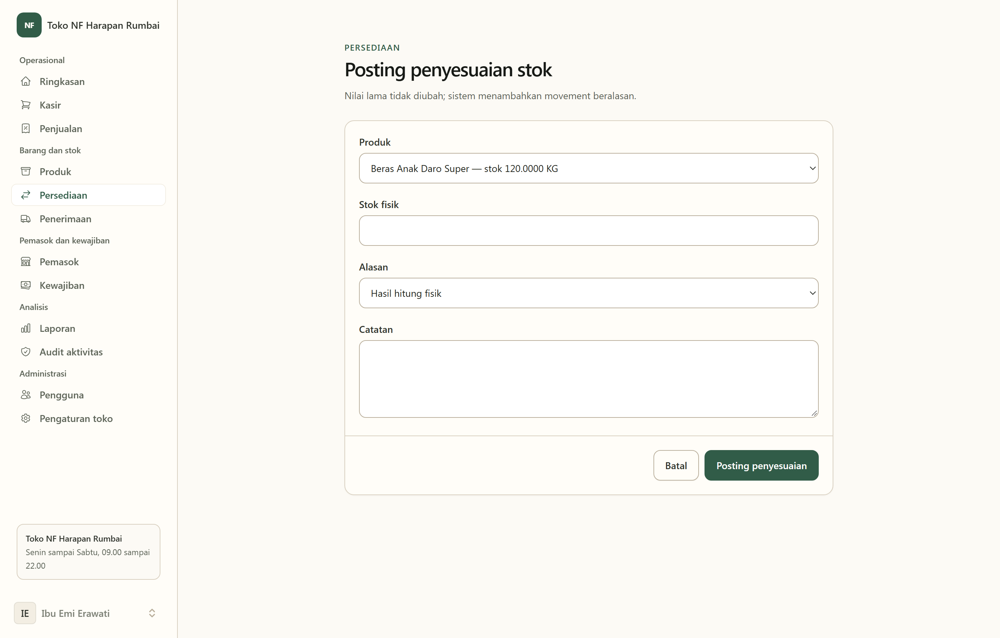
*Gambar 4.27 Implementasi Antarmuka Halaman Form Penyesuaian Stok Fisik*

Formulir pada Gambar 4.27 memfasilitasi pemilik toko untuk memilih barang yang diperiksa, mengisi jumlah fisik hasil perhitungan nyata di gudang, memilih kategori alasan koreksi (seperti hitung fisik rutin, barang rusak, susut timbangan, atau kedaluwarsa), dan menambahkan catatan keterangan.

11. **Halaman Pengelolaan Data Pemasok**: Daftar distributor dan agen pemasok barang dagangan Toko NF Harapan Rumbai dikelola melalui halaman data pemasok sebagaimana terlihat pada Gambar 4.28.

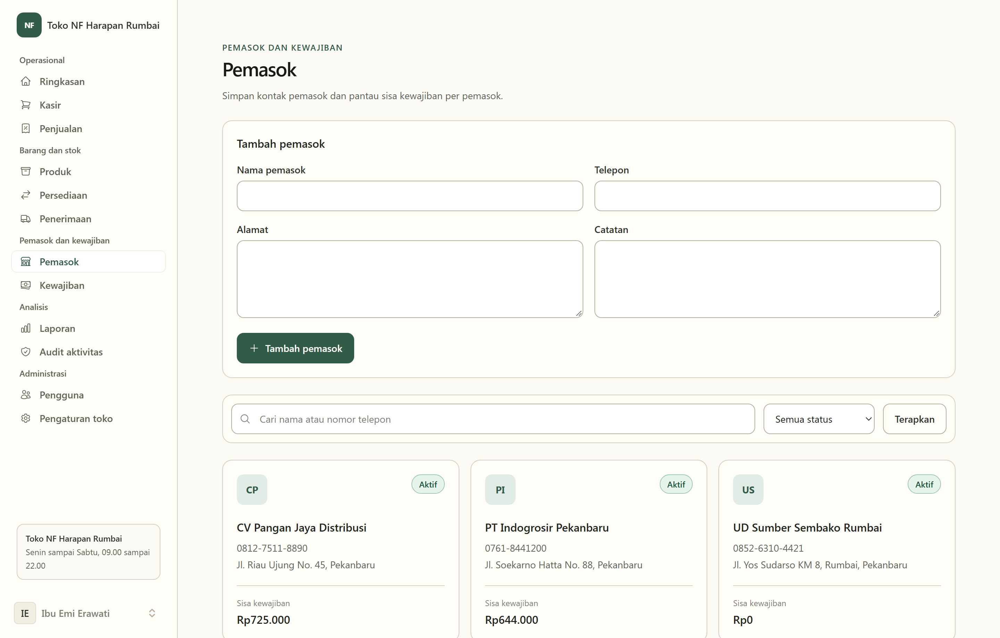
*Gambar 4.28 Implementasi Antarmuka Halaman Pengelolaan Data Pemasok*

Pada Gambar 4.28 tampak daftar mitra pemasok aktif seperti PT Indogrosir Pekanbaru, CV Pangan Jaya Distribusi, dan UD Sumber Sembako Rumbai lengkap dengan nama narahubung, nomor telepon, alamat, serta tautan menuju riwayat pasokan barangnya.

12. **Halaman Rincian Penerimaan Barang Pemasok**: Setelah barang masuk dari pemasok selesai dicatat, rincian bukti penerimaan barang ditampilkan seperti terlihat pada Gambar 4.29.

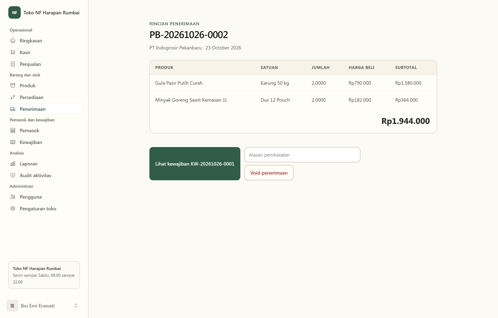
*Gambar 4.29 Implementasi Antarmuka Halaman Detail Penerimaan Barang Pemasok*

Gambar 4.29 memperlihatkan bukti penerimaan barang dari PT Indogrosir Pekanbaru senilai Rp1.944.000 yang langsung terhubung dengan kartu tagihan hutang pemasok karena penerimaan barang tersebut dibayar secara bertahap.

13. **Halaman Rincian Hutang Pemasok dan Riwayat Pembayaran**: Pemantauan sisa hutang dagang kepada pemasok, pencatatan pembayaran cicilan atau pelunasan, serta pengunduhan bukti transfer dilakukan pada halaman rincian kewajiban pemasok yang ditunjukkan pada Gambar 4.30.

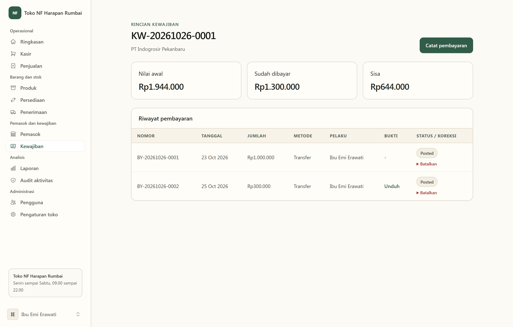
*Gambar 4.30 Implementasi Antarmuka Halaman Rincian Kewajiban Pemasok dan Riwayat Pembayaran*

Pada Gambar 4.30 terlihat bahwa tagihan hutang kepada pemasok tersebut memiliki nilai pokok awal sebesar Rp1.944.000, telah dicicil sebanyak dua kali dengan total Rp1.300.000, sehingga menyisakan saldo hutang sebesar Rp644.000. Pada tabel riwayat pembayaran juga tersedia tombol unduh untuk memeriksa berkas bukti transfer yang tersimpan.

14. **Halaman Laporan Operasional dan Ekspor Dokumen**: Rekapitulasi transaksi penjualan, mutasi stok, penerimaan barang, dan hutang pemasok dapat diperiksa serta diunduh melalui halaman laporan operasional sebagaimana ditampilkan pada Gambar 4.31.

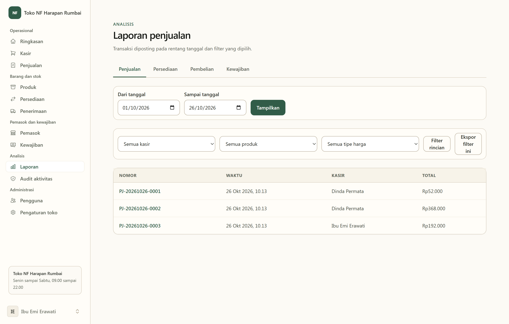
*Gambar 4.31 Implementasi Antarmuka Halaman Laporan Operasional dan Ekspor CSV/PDF*

Halaman laporan pada Gambar 4.31 menyediakan penyaring rentang tanggal serta tombol pengunduhan langsung ke dalam format tabel CSV maupun dokumen PDF siap cetak untuk memudahkan pengarsipan bulanan pemilik toko.

15. **Halaman Pengelolaan Pengguna Internal**: Pengaturan akun staf dan pembagian hak akses dilakukan oleh Pemilik Toko melalui halaman manajemen pengguna yang ditunjukkan pada Gambar 4.32.

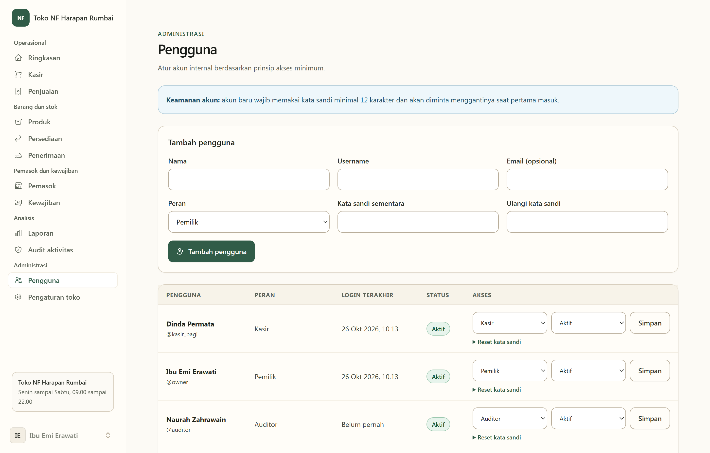
*Gambar 4.32 Implementasi Antarmuka Halaman Manajemen Pengguna Internal*

Gambar 4.32 menampilkan formulir penambahan akun staf di bagian atas serta tabel daftar pengguna internal toko (Ibu Emi Erawati sebagai Pemilik Toko, Rina Wulandari sebagai Admin Gudang, Dinda Permata sebagai Kasir, dan Naurah Zahrawain sebagai Pemeriksa Internal) di bagian bawah.

16. **Halaman Jejak Aktivitas Pengguna (*Audit Log*)**: Seluruh catatan aktivitas penting yang terjadi di dalam sistem dapat ditelusuri oleh Pemilik Toko dan Pemeriksa Internal melalui halaman jejak aktivitas sebagaimana disajikan pada Gambar 4.33.

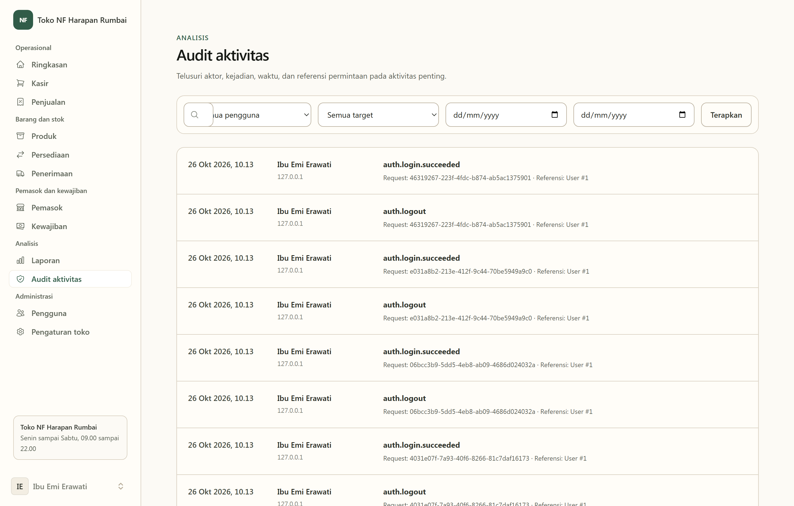
*Gambar 4.33 Implementasi Antarmuka Halaman Audit Log Aktivitas Sistem*

Pada Gambar 4.33 terlihat setiap aktivitas operasional seperti penyesuaian stok fisik, penyelesaian transaksi penjualan, pencatatan pembayaran hutang, dan penerimaan barang masuk terekam lengkap beserta waktu kejadian, nama petugas pelaku, serta rincian perubahan datanya.

### 4.2.4. Pengujian Sistem

Pengujian sistem dilakukan melalui dua tahapan yang saling melengkapi, yaitu pengujian fungsional metode *Black Box Testing* untuk memastikan kesesuaian logika masukan dan keluaran pada setiap modul aplikasi, serta pengujian penerimaan pengguna (*User Acceptance Testing* / UAT) untuk menilai kemudahan dan kelayakan penerapan sistem bagi pihak Toko NF Harapan Rumbai.

#### 4.2.4.1. Pengujian Fungsional per Modul (Black Box Testing)

Pengujian *Black Box* dilaksanakan dengan menguji 37 skenario fungsional yang mencakup sembilan modul utama aplikasi, baik menggunakan skenario pengisian data yang benar (alur normal) maupun pengisian data yang tidak sah (alur batas dan penolakan wewenang). Rincian skenario dan hasil pengujian untuk kesembilan modul diuraikan pada Tabel 4.30 hingga Tabel 4.38.

**Tabel 4.30 Hasil Pengujian Black Box Modul Autentikasi dan Keamanan Sesi**

| Kode Uji | Skenario Pengujian | Data Masukan | Hasil yang Diharapkan | Hasil Pengamatan | Status |
| --- | --- | --- | --- | --- | --- |
| BB-01 | Masuk menggunakan akun pengguna aktif yang terdaftar | Nama pengguna dan kata sandi pemilik toko yang benar | Sistem membuka sesi pengguna dan menampilkan halaman ringkasan utama. | Pengguna berhasil masuk ke halaman Ringkasan Pemilik Toko. | Valid |
| BB-02 | Masuk menggunakan kata sandi yang salah | Nama pengguna benar, tetapi kata sandi diisi keliru | Sistem menolak akses masuk dan menampilkan pesan peringatan kesalahan kata sandi. | Pesan kesalahan tampil di layar dan pengguna tidak dapat masuk. | Valid |
| BB-03 | Masuk menggunakan akun staf yang sedang dinonaktifkan | Akun kasir yang status keaktifannya telah dinonaktifkan oleh pemilik | Sistem menolak akses masuk dan mengembalikan pengguna ke halaman masuk. | Akses akun nonaktif ditolak sepenuhnya sesuai aturan keamanan. | Valid |
| BB-04 | Percobaan masuk gagal berulang kali melebihi batas maksimum | Enam kali percobaan masuk gagal secara berturut-turut dalam satu menit | Sistem menahan sementara percobaan masuk berikutnya untuk mencegah tebakan kata sandi. | Percobaan keenam ditahan sementara disertai pesan batas percobaan. | Valid |
| BB-05 | Kewajiban mengganti kata sandi awal bagi akun staf baru | Akun staf baru yang ditandai wajib mengganti kata sandi saat masuk pertama kali | Sistem mengarahkan pengguna ke formulir pembaruan kata sandi sebelum membuka menu lain. | Pengguna langsung diarahkan ke halaman ganti kata sandi baru. | Valid |

**Tabel 4.31 Hasil Pengujian Black Box Modul Otorisasi dan Administrasi Pengguna**

| Kode Uji | Skenario Pengujian | Data Masukan | Hasil yang Diharapkan | Hasil Pengamatan | Status |
| --- | --- | --- | --- | --- | --- |
| BB-06 | Pemilik toko menambahkan akun staf baru dengan peran Kasir | Nama lengkap, nama pengguna, kata sandi awal, dan pilihan peran Kasir | Akun staf baru tersimpan di basis data dan aktivitas pembuatan akun tercatat. | Akun kasir baru berhasil dibuat dan muncul pada tabel daftar pengguna. | Valid |
| BB-07 | Petugas Kasir mencoba membuka halaman pengelolaan pengguna internal | Akses langsung ke menu pengaturan pengguna menggunakan akun Kasir | Sistem menolak permintaan akses dan menampilkan halaman penolakan izin. | Akses ditolak karena fitur tersebut khusus untuk Pemilik Toko. | Valid |
| BB-08 | Pemeriksa Internal membuka halaman jejak aktivitas tetapi mencoba mengubah data pengguna | Membuka daftar jejak aktivitas lalu mengirim permintaan tambah pengguna | Halaman jejak aktivitas dapat dibaca, tetapi perubahan data pengguna ditolak. | Pemeriksa hanya dapat melihat data tanpa bisa mengubah catatan. | Valid |
| BB-09 | Pembaruan informasi profil dan catatan kaki struk Toko NF Harapan Rumbai | Nama toko, alamat lengkap, nomor telepon, dan pesan penutup struk belanja | Perubahan profil toko tersimpan dan langsung tampil pada cetakan struk kasir. | Identitas toko pada struk berhasil diperbarui sesuai isian. | Valid |

**Tabel 4.32 Hasil Pengujian Black Box Modul Katalog Produk, Multi-Satuan, dan Harga**

| Kode Uji | Skenario Pengujian | Data Masukan | Hasil yang Diharapkan | Hasil Pengamatan | Status |
| --- | --- | --- | --- | --- | --- |
| BB-10 | Menambahkan kategori barang dan satuan ukur baru | Kategori Sembako dan satuan ukur Kilogram dengan ketelitian desimal | Data kategori dan satuan ukur tersimpan tanpa ada duplikasi kode satuan. | Kategori dan satuan ukur baru berhasil tersimpan di katalog. | Valid |
| BB-11 | Menambahkan barang dagangan baru dengan satuan dasar Kilogram | Kode barang SMB-001, nama Gula Pasir Putih Curah, batas stok menipis 20 kg | Data induk barang tersimpan beserta satuan jual dasar 1 kilogram. | Barang baru berhasil terdaftar dan tampil pada katalog toko. | Valid |
| BB-12 | Menambahkan satuan jual takaran pecahan (1/2 kg dan 1/4 kg) | Kemasan jual 1/2 kg (setara 0,5 kg) dan 1/4 kg (setara 0,25 kg) | Kedua satuan jual pecahan tersimpan akurat dengan rasio konversi masing-masing. | Pilihan takaran 1/2 kg dan 1/4 kg berhasil tersimpan dan muncul di kasir. | Valid |
| BB-13 | Menetapkan aturan harga eceran dan harga grosir pada satu satuan jual | Harga eceran Rp18.000 (minimal beli 1) dan harga grosir Rp17.000 (minimal beli 10) | Kedua tingkatan harga tersimpan aktif sesuai syarat jumlah pembelian minimum. | Harga eceran dan harga grosir berhasil tersimpan pada barang terkait. | Valid |
| BB-14 | Mencoba mendaftarkan barang baru menggunakan kode barang yang sudah terpakai | Pengisian formulir barang baru dengan kode SMB-001 yang sudah terdaftar | Sistem menolak penyimpanan dan menampilkan peringatan bahwa kode barang sudah ada. | Penyimpanan ditolak disertai pesan peringatan duplikasi kode barang. | Valid |

**Tabel 4.33 Hasil Pengujian Black Box Modul Transaksi Kasir Point of Sale (POS)**

| Kode Uji | Skenario Pengujian | Data Masukan | Hasil yang Diharapkan | Hasil Pengamatan | Status |
| --- | --- | --- | --- | --- | --- |
| BB-15 | Transaksi penjualan eceran biasa dengan pembayaran uang tunai | Pembelian 2 bungkus Gula Pasir 1 kg dengan uang tunai diterima Rp50.000 | Sistem menggunakan harga eceran Rp18.000, total Rp36.000, kembalian Rp14.000, dan mengurangi stok 2 kg. | Nota penjualan terbentuk, kembalian tepat Rp14.000, dan stok berkurang 2 kg. | Valid |
| BB-16 | Penerapan harga grosir otomatis ketika jumlah beli memenuhi batas minimum | Pembelian 12 bungkus Minyak Goreng 1 Liter (syarat grosir minimal 12 bungkus) | Sistem otomatis beralih menerapkan harga grosir Rp16.500 per bungkus dengan subtotal Rp198.000. | Label harga otomatis berubah menjadi Grosir dengan subtotal Rp198.000. | Valid |
| BB-17 | Transaksi penjualan barang curah menggunakan satuan takaran pecahan | Pembelian 1 bungkus Gula Pasir 1/2 kg dan 1 bungkus Telur Ayam 1/4 kg | Saldo stok dasar Gula Pasir berkurang 0,5 kg dan saldo stok dasar Telur Ayam berkurang 0,25 kg. | Catatan mutasi stok memotong 0,5 kg dan 0,25 kg secara tepat tanpa selisih. | Valid |
| BB-18 | Penolakan transaksi apabila jumlah barang yang dibeli melebihi stok tersedia | Pengisian jumlah beli 500 kg Gula Pasir saat saldo stok di gudang hanya 186,5 kg | Sistem membatalkan transaksi dan menampilkan pesan peringatan bahwa stok tidak mencukupi. | Transaksi ditolak sepenuhnya dan saldo persediaan tidak berkurang. | Valid |
| BB-19 | Penolakan transaksi tunai ketika nominal uang diterima kurang dari total tagihan | Total tagihan belanja Rp36.000, tetapi nominal uang diterima diisi Rp20.000 | Sistem menolak penyelesaian transaksi dan meminta kasir memeriksa nominal uang pembayaran. | Pesan peringatan pembayaran kurang tampil dan transaksi tidak tersimpan. | Valid |
| BB-20 | Pencegahan pencatatan nota ganda saat tombol simpan ditekan dua kali beruntun | Penekanan tombol Selesaikan Transaksi secara berulang pada sesi belanja yang sama | Sistem hanya memproses transaksi satu kali dan tidak memotong stok barang secara ganda. | Hanya satu nomor nota penjualan yang terbentuk dan stok terpotong satu kali. | Valid |

**Tabel 4.34 Hasil Pengujian Black Box Modul Buku Besar Persediaan dan Penyesuaian Stok**

| Kode Uji | Skenario Pengujian | Data Masukan | Hasil yang Diharapkan | Hasil Pengamatan | Status |
| --- | --- | --- | --- | --- | --- |
| BB-21 | Pemeriksaan kesesuaian antara tabel saldo stok saat ini dan riwayat mutasi stok | Pemeriksaan halaman Saldo Persediaan dan halaman Riwayat Pergerakan Stok | Jumlah saldo stok terkini pada setiap barang selalu sama dengan angka saldo akhir pada mutasi terakhirnya. | Seluruh saldo barang terbukti konsisten dengan riwayat mutasi keluar-masuk. | Valid |
| BB-22 | Pencatatan penyesuaian stok fisik (*stock opname*) oleh Pemilik Toko | Barang Telur Ayam, stok tercatat 11,75 kg, stok fisik nyata 11,5 kg, alasan barang rusak | Sistem mencatat mutasi koreksi sebesar -0,25 kg, memperbarui saldo menjadi 11,5 kg, dan merekam jejak aktivitas. | Penyesuaian stok berhasil disimpan dan saldo terkini berubah menjadi 11,5 kg. | Valid |
| BB-23 | Penolakan penyesuaian stok fisik tanpa alasan atau oleh selain Pemilik Toko | Formulir koreksi stok dikirim tanpa memilih alasan atau diakses oleh Admin Gudang | Sistem menolak penyimpanan karena koreksi stok fisik wajib disertai alasan dan hanya diizinkan bagi Pemilik Toko. | Permintaan ditolak sesuai aturan pengendalian persediaan toko. | Valid |

**Tabel 4.35 Hasil Pengujian Black Box Modul Pemasok dan Penerimaan Barang**

| Kode Uji | Skenario Pengujian | Data Masukan | Hasil yang Diharapkan | Hasil Pengamatan | Status |
| --- | --- | --- | --- | --- | --- |
| BB-24 | Menambahkan dan memperbarui informasi mitra pemasok barang | Nama perusahaan PT Indogrosir Pekanbaru beserta nomor telepon dan alamat gudang | Data pemasok tersimpan dengan benar dan muncul pada pilihan pemasok di formulir barang masuk. | Data pemasok berhasil disimpan dan siap dipilih saat pengadaan barang. | Valid |
| BB-25 | Pencatatan penerimaan barang dari pemasok dengan status pembayaran lunas penuh | Total nilai nota Rp336.000 dengan pembayaran awal lunas sebesar Rp336.000 | Bukti penerimaan barang tersimpan lunas, stok gudang bertambah sesuai konversi kemasan, dan tidak membentuk hutang. | Saldo stok bertambah secara otomatis dan tidak ada tagihan hutang baru. | Valid |
| BB-26 | Pencatatan penerimaan barang dengan pembayaran sebagian (cicilan awal) | Total nilai nota Rp1.944.000, pembayaran awal Rp1.000.000, jatuh tempo 3 hari ke depan | Stok barang bertambah dan sistem otomatis membentuk kartu hutang pemasok dengan sisa tagihan Rp944.000. | Kartu hutang pemasok otomatis terbentuk sebesar Rp944.000 berstatus dicicil sebagian. | Valid |
| BB-27 | Penolakan penerimaan barang secara kredit apabila tanggal jatuh tempo dikosongkan | Total nilai nota Rp725.000, pembayaran awal Rp0 (hutang penuh), tanggal jatuh tempo kosong | Sistem menolak penyimpanan dan mewajibkan pengisian tanggal jatuh tempo pelunasan. | Pesan peringatan wajib isi tanggal jatuh tempo tampil dan data belum disimpan. | Valid |

**Tabel 4.36 Hasil Pengujian Black Box Modul Kewajiban Pemasok dan Pengingat Jatuh Tempo**

| Kode Uji | Skenario Pengujian | Data Masukan | Hasil yang Diharapkan | Hasil Pengamatan | Status |
| --- | --- | --- | --- | --- | --- |
| BB-28 | Tampilan pengingat hutang jatuh tempo (H-7) dan lewat jatuh tempo pada halaman utama | Data tagihan hutang yang jatuh tempo 3 hari lagi dan tagihan yang sudah lewat 2 hari | Kedua tagihan muncul pada daftar peringatan dini di halaman utama pemilik toko dan dapat disaring berdasarkan statusnya. | Kartu pengingat dan tabel daftar hutang menampilkan penanda jatuh tempo secara tepat. | Valid |
| BB-29 | Pencatatan pembayaran cicilan hutang pemasok disertai bukti transfer | Tagihan dengan sisa Rp944.000 dibayar cicilan kedua sebesar Rp300.000 beserta berkas bukti PDF | Bukti pembayaran baru tersimpan, total terbayar naik menjadi Rp1.300.000, dan sisa hutang turun menjadi Rp644.000. | Sisa saldo hutang langsung terbarui menjadi Rp644.000 dengan status masih dicicil. | Valid |
| BB-30 | Pencatatan pelunasan akhir atas seluruh sisa tagihan hutang pemasok | Pengisian pembayaran sebesar seluruh sisa saldo hutang yakni Rp644.000 | Sisa saldo hutang menjadi Rp0 dan status tagihan otomatis berubah menjadi Lunas. | Status kartu hutang pemasok berubah otomatis menjadi Lunas Penuh. | Valid |
| BB-31 | Penolakan pembayaran hutang apabila nominal yang diisi melebihi sisa tagihan | Sisa tagihan hutang Rp644.000, tetapi nominal pembayaran diisi sebesar Rp800.000 | Sistem menolak penyimpanan dan menampilkan peringatan bahwa nominal pembayaran melebihi sisa hutang. | Transaksi pembayaran ditolak dan sisa hutang tetap tercatat sebesar Rp644.000. | Valid |

**Tabel 4.37 Hasil Pengujian Black Box Modul Lampiran Dokumen Bukti dan Pembatalan Transaksi**

| Kode Uji | Skenario Pengujian | Data Masukan | Hasil yang Diharapkan | Hasil Pengamatan | Status |
| --- | --- | --- | --- | --- | --- |
| BB-32 | Pengunggahan dan pengunduhan berkas bukti transaksi berformat gambar atau PDF | Berkas dokumen bukti transfer berformat PDF dengan ukuran 148 KB | Berkas tersimpan di ruang penyimpanan internal tertutup dan hanya dapat diunduh oleh pengguna internal yang berwenang. | Berkas bukti berhasil disimpan dan dapat diunduh kembali melalui tombol unduh. | Valid |
| BB-33 | Penolakan pengunggahan berkas berbahaya yang bukan berupa gambar atau PDF | Berkas program komputer yang namanya diubah seolah-olah menjadi berkas gambar | Sistem memeriksa keaslian isi berkas dan menolak pengunggahan berkas yang tidak sah. | Pengunggahan ditolak disertai pesan bahwa format berkas tidak diizinkan. | Valid |
| BB-34 | Pembatalan resmi (*void*) nota penjualan oleh Pemilik Toko beserta pengembalian stok | Permintaan pembatalan nota penjualan oleh Pemilik Toko disertai alasan pembatalan | Status nota berubah menjadi dibatalkan, sistem otomatis mengembalikan jumlah stok barang ke gudang, dan mencatat jejak aktivitas. | Nota berhasil dibatalkan dan saldo persediaan barang kembali seperti semula. | Valid |

**Tabel 4.38 Hasil Pengujian Black Box Modul Laporan Operasional, Ekspor, dan Jejak Aktivitas**

| Kode Uji | Skenario Pengujian | Data Masukan | Hasil yang Diharapkan | Hasil Pengamatan | Status |
| --- | --- | --- | --- | --- | --- |
| BB-35 | Penyaringan periode tanggal pada laporan penjualan, stok, pembelian, dan hutang pemasok | Pemilihan tanggal awal dan tanggal akhir bulan berjalan pada halaman laporan | Tabel laporan hanya menyajikan rincian transaksi yang terjadi di dalam rentang tanggal yang dipilih. | Data laporan tersaring secara akurat sesuai periode tanggal yang ditentukan. | Valid |
| BB-36 | Pengunduhan laporan operasional ke dalam berkas tabel CSV dan dokumen PDF siap cetak | Penekanan tombol Unduh CSV dan tombol Unduh PDF pada halaman Laporan Penjualan | Peramban mengunduh berkas CSV dan PDF dengan rincian angka yang sama persis dengan tampilan layar. | Berkas CSV dan PDF berhasil terunduh serta dapat dibuka dengan rapi. | Valid |
| BB-37 | Pencarian riwayat kejadian pada halaman Jejak Aktivitas Pengguna | Pencarian berdasarkan jenis aktivitas penjualan atau penerimaan barang masuk | Tabel jejak aktivitas menampilkan daftar kejadian beserta waktu, nama petugas pelaku, dan rincian perubahan datanya. | Riwayat aktivitas operasional tampil lengkap dan mudah ditelusuri. | Valid |

Di samping pengujian fungsional pada kesembilan tabel di atas, dilakukan pula pengujian otomatis terhadap seluruh aturan perhitungan konversi satuan, penentuan harga bertingkat, pembagian izin akses, serta konsistensi saldo persediaan. Rekapitulasi tingkat keberhasilan pengujian *Black Box* pada setiap modul disajikan pada Tabel 4.39.

**Tabel 4.39 Rekapitulasi Hasil Pengujian Black Box pada Seluruh Modul Sistem**

| No. | Nama Modul Pengujian | Jumlah Butir Uji | Berhasil (Valid) | Gagal (Tidak Valid) | Persentase Keberhasilan |
| --- | --- | --- | --- | --- | --- |
| 1 | Modul Autentikasi dan Keamanan Sesi | 5 | 5 | 0 | 100% |
| 2 | Modul Otorisasi dan Administrasi Pengguna | 4 | 4 | 0 | 100% |
| 3 | Modul Katalog Produk, Multi-Satuan, dan Harga | 5 | 5 | 0 | 100% |
| 4 | Modul Transaksi Kasir *Point of Sale* (POS) | 6 | 6 | 0 | 100% |
| 5 | Modul Buku Besar Persediaan dan Penyesuaian Stok | 3 | 3 | 0 | 100% |
| 6 | Modul Pemasok dan Penerimaan Barang | 4 | 4 | 0 | 100% |
| 7 | Modul Kewajiban Pemasok dan Pengingat Jatuh Tempo | 4 | 4 | 0 | 100% |
| 8 | Modul Lampiran Dokumen Bukti dan Pembatalan Transaksi | 3 | 3 | 0 | 100% |
| 9 | Modul Laporan Operasional, Ekspor, dan Jejak Aktivitas | 3 | 3 | 0 | 100% |
| Total | Seluruh Modul Sistem Informasi Toko NF Harapan Rumbai | 37 | 37 | 0 | 100% |

Rekapitulasi pada Tabel 4.39 membuktikan bahwa seluruh 37 butir skenario pengujian *Black Box* menghasilkan keluaran yang sesuai dengan rancangan kebutuhan (tingkat keberhasilan 100%). Hasil ini juga sejalan dengan 59 skenario pengujian otomatis yang seluruhnya berjalan sukses tanpa celah kesalahan perhitungan.

#### 4.2.4.2. Pengujian Penerimaan Pengguna (User Acceptance Testing / UAT)

Setelah seluruh fungsi dinyatakan valid pada tahap pengujian fungsional, dilakukan pengujian penerimaan pengguna (*User Acceptance Testing* / UAT) bersama pihak Toko NF Harapan Rumbai yang melibatkan Pemilik Toko, Admin Gudang, dan Petugas Kasir (total 3 responden internal). Setiap responden mengoperasikan langsung fitur sistem sesuai tugas hariannya kemudian memberikan penilaian menggunakan skala Likert 1 sampai 5 sebagaimana tercantum pada Tabel 4.40.

**Tabel 4.40 Bobot Skala Penilaian dan Kriteria Interpretasi User Acceptance Testing (UAT)**

| Skor Skala | Kategori Penilaian Jawaban | Rentang Persentase Skor | Interpretasi Kelayakan |
| --- | --- | --- | --- |
| 5 | Sangat Setuju (SS) | 81% - 100% | Sangat Layak / Sangat Diterima |
| 4 | Setuju (S) | 61% - 80% | Layak / Diterima |
| 3 | Cukup Setuju (CS) | 41% - 60% | Cukup Layak |
| 2 | Tidak Setuju (TS) | 21% - 40% | Kurang Layak |
| 1 | Sangat Tidak Setuju (STS) | 0% - 20% | Tidak Layak |

Skor tertinggi untuk setiap butir pernyataan dengan 3 responden dan bobot maksimal 5 adalah 15 poin. Rincian hasil penilaian responden terhadap sepuluh pernyataan evaluasi UAT disajikan pada Tabel 4.41.

**Tabel 4.41 Hasil Perhitungan Kuesioner User Acceptance Testing (UAT) Pengguna Toko NF Harapan Rumbai**

| No. | Pernyataan Evaluasi Penerimaan Pengguna | SS (5) | S (4) | CS (3) | TS (2) | STS (1) | Total Skor | Persentase |
| --- | --- | --- | --- | --- | --- | --- | --- | --- |
| 1 | Tampilan antarmuka aplikasi bersih, mudah dibaca, dan menu navigasi mudah dipahami oleh pengguna toko. | 2 | 1 | 0 | 0 | 0 | 14 | 93,33% |
| 2 | Halaman Kasir POS mempercepat pencatatan transaksi penjualan dibandingkan penulisan nota manual. | 3 | 0 | 0 | 0 | 0 | 15 | 100,00% |
| 3 | Fitur pemilihan satuan jual (1 kg, 1/2 kg, 1/4 kg, dus, atau karung) sesuai dengan cara jualan harian di Toko NF Harapan Rumbai. | 3 | 0 | 0 | 0 | 0 | 15 | 100,00% |
| 4 | Penentuan harga eceran dan harga grosir otomatis di layar kasir membantu mencegah kesalahan hitung harga. | 3 | 0 | 0 | 0 | 0 | 15 | 100,00% |
| 5 | Struk penjualan yang dihasilkan memuat informasi barang, pembayaran, dan kembalian dengan jelas. | 2 | 1 | 0 | 0 | 0 | 14 | 93,33% |
| 6 | Saldo stok barang dan riwayat keluar-masuk stok dapat dipantau dengan akurat setiap saat. | 2 | 1 | 0 | 0 | 0 | 14 | 93,33% |
| 7 | Pencatatan penerimaan barang dari pemasok yang otomatis membentuk catatan hutang memudahkan administrasi toko. | 3 | 0 | 0 | 0 | 0 | 15 | 100,00% |
| 8 | Pengingat hutang mendekati jatuh tempo (H-7) dan lewat jatuh tempo di halaman utama membantu pemilik toko membayar tagihan tepat waktu. | 3 | 0 | 0 | 0 | 0 | 15 | 100,00% |
| 9 | Fitur unggah bukti nota atau transfer dan pengunduhan laporan (CSV/PDF) memudahkan pengarsipan dan pemeriksaan usaha. | 2 | 1 | 0 | 0 | 0 | 14 | 93,33% |
| 10 | Pembagian hak akses antara Pemilik Toko, Admin Gudang, dan Kasir sudah sesuai dengan tanggung jawab kerja di toko. | 2 | 1 | 0 | 0 | 0 | 14 | 93,33% |
| Total | Rata-Rata Hasil Evaluasi Penerimaan Pengguna (UAT) | 25 | 5 | 0 | 0 | 0 | 145 / 150 | 96,67% |

Berdasarkan Tabel 4.41, total nilai yang diperoleh dari 10 butir pernyataan adalah 145 dari nilai maksimal 150, atau setara dengan persentase rata-rata sebesar 96,67%. Merujuk pada kriteria interpretasi di Tabel 4.40, capaian 96,67% berada pada rentang 81% - 100% (*Sangat Layak / Sangat Diterima*). Responden memberikan penilaian penuh (100%) terutama pada kemampuan konversi takaran pecahan, otomatisasi penentuan harga eceran dan grosir, serta pengingat jatuh tempo hutang pemasok karena ketiga fitur tersebut menjawab kendala operasional harian di Toko NF Harapan Rumbai.

### 4.2.5. Kelebihan dan Keterbatasan Sistem

Berdasarkan hasil implementasi dan evaluasi penggunaan secara langsung di lapangan, sistem informasi yang dibangun memiliki sejumlah kelebihan utama sekaligus beberapa keterbatasan yang dapat menjadi acuan pengembangan selanjutnya.

**Kelebihan Sistem:**
1. Mendukung pengelolaan barang multi-satuan dan takaran pecahan (mulai dari 1 kg, 1/2 kg, 1/4 kg, hingga satuan dus dan karung) secara presisi yang langsung terhubung dengan pemotongan maupun penambahan saldo dasar persediaan di gudang.
2. Menerapkan pemilihan harga eceran dan harga grosir secara otomatis berdasarkan syarat jumlah pembelian minimum, sehingga petugas kasir tidak perlu menghafal daftar harga bertingkat dan risiko salah hitung dapat ditekan.
3. Mengintegrasikan pencatatan barang masuk dari pemasok dengan pembentukan kartu hutang dagang otomatis beserta pengingat tagihan jatuh tempo tujuh hari sebelumnya (H-7) dan tagihan yang melewati jatuh tempo.
4. Menjaga keutuhan catatan stok dan keuangan toko melalui pencegahan pengiriman transaksi ganda, kewajiban prosedur pembatalan resmi (*void*) yang mengembalikan stok secara utuh, penyimpanan tertutup untuk berkas bukti nota atau transfer, serta pencatatan jejak aktivitas pengguna.

**Keterbatasan Sistem:**
1. Sistem dirancang khusus untuk mengelola kegiatan operasional pada satu lokasi toko tunggal di Toko NF Harapan Rumbai, sehingga belum mendukung penyelarasan stok antar-cabang.
2. Pencatatan metode pembayaran non-tunai (QRIS dan Transfer Bank) berfungsi sebagai pencatatan transaksi kasir dan pengarsipan bukti bayar, belum terhubung langsung dengan layanan verifikasi perbankan otomatis.
3. Aplikasi berfokus pada pengelolaan penjualan, persediaan, dan hutang dagang pemasok, sehingga belum mencakup penyusunan laporan akuntansi keuangan lengkap seperti neraca atau perhitungan laba bersih berbasis harga pokok penjualan.

### 4.2.6. Evaluasi Ketercapaian Tujuan dan Manfaat Kerja Praktik

Sebagai penutup pembahasan pada Bab IV, dilakukan evaluasi ketercapaian untuk memastikan bahwa seluruh rumusan masalah dan tujuan kerja praktik yang telah ditetapkan pada Bab I telah diselesaikan melalui fitur-fitur sistem yang diimplementasikan. Matriks evaluasi ketercapaian tujuan kerja praktik disajikan pada Tabel 4.42.

**Tabel 4.42 Evaluasi Ketercapaian Tujuan Kerja Praktik terhadap Implementasi Sistem**

| No. | Rumusan Tujuan Kerja Praktik (Bab I) | Modul & Fitur Penyelesaian pada Bab IV | Bukti Implementasi & Pengujian | Status Capaian |
| --- | --- | --- | --- | --- |
| 1 | Membangun sistem informasi *Point of Sale* (POS) dan inventaris berbasis web untuk menggantikan pencatatan manual di Toko NF Harapan Rumbai. | Modul Kasir Penjualan, Riwayat Nota Penjualan, dan Buku Besar Persediaan Barang. | Gambar 4.24, Gambar 4.25, Gambar 4.26; Pengujian BB-15 s.d. BB-21 (100% Valid). | Tercapai |
| 2 | Menyediakan pengelolaan barang multi-satuan dan penentuan harga eceran maupun grosir secara otomatis. | Modul Katalog Barang, Pengaturan Satuan Konversi Pecahan, dan Aturan Harga Bertingkat Eceran/Grosir. | Gambar 4.21, Gambar 4.22, Gambar 4.23; Pengujian BB-10 s.d. BB-17 (100% Valid). | Tercapai |
| 3 | Mengelola pencatatan barang masuk dari pemasok, kewajiban pembayaran hutang, bukti transaksi, dan pengingat jatuh tempo. | Modul Data Pemasok, Penerimaan Barang Masuk, Kartu Hutang Pemasok, Pengingat Jatuh Tempo H-7, dan Lampiran Bukti. | Gambar 4.19, Gambar 4.28, Gambar 4.29, Gambar 4.30; Pengujian BB-24 s.d. BB-33 (100% Valid). | Tercapai |
| 4 | Menyajikan laporan operasional penjualan, stok, pembelian, dan hutang pemasok yang akurat beserta pembagian hak akses pengguna. | Modul Laporan Operasional & Unduh CSV/PDF, Pembagian Hak Akses Empat Peran, serta Jejak Aktivitas Pengguna. | Gambar 4.31, Gambar 4.32, Gambar 4.33; Pengujian BB-06 s.d. BB-09 & BB-35 s.d. BB-37; Skor UAT 96,67%. | Tercapai |

Berdasarkan matriks evaluasi pada Tabel 4.42, keempat tujuan pelaksanaan kerja praktik di Toko NF Harapan Rumbai telah tercapai sepenuhnya serta terverifikasi baik melalui pengujian fungsional maupun evaluasi penerimaan pengguna.
