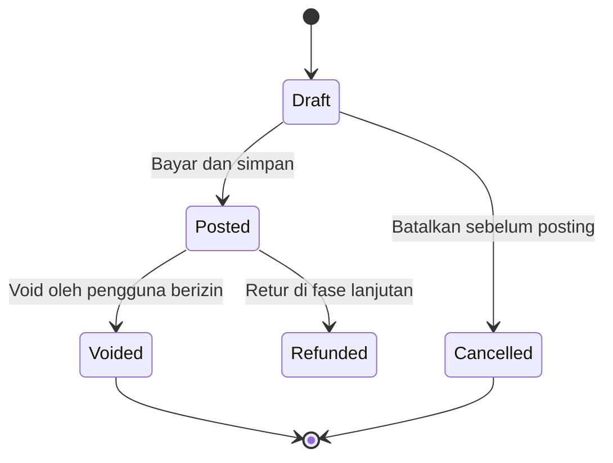
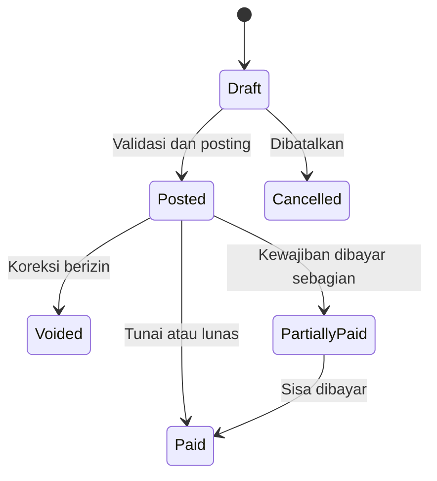

# Domain Rules

## Prinsip Umum

Aturan domain harus berada pada service atau action layer dan diuji. UI, Livewire component, dan controller tidak menjadi satu-satunya tempat aturan bisnis.

## Uang

| ID | Aturan |
|---|---|
| `BR-MONEY-01` | Semua nilai uang disimpan sebagai integer rupiah. |
| `BR-MONEY-02` | Nilai uang tidak boleh negatif kecuali pada record pembalik yang eksplisit. |
| `BR-MONEY-03` | Total item = kuantitas jual x harga per satuan setelah aturan pembulatan yang disetujui. |
| `BR-MONEY-04` | Total transaksi dihitung ulang server-side, tidak mempercayai total dari browser. |
| `BR-MONEY-05` | Pembayaran tunai tidak boleh lebih kecil dari total, kecuali tipe pembayaran kredit pelanggan kelak ditambahkan. |
| `BR-MONEY-06` | Kembalian = pembayaran diterima - total transaksi. |
| `BR-MONEY-07` | Jumlah pembayaran kewajiban tidak boleh melebihi sisa kewajiban. |

## Kuantitas dan Satuan

| ID | Aturan |
|---|---|
| `BR-UNIT-01` | Setiap produk memiliki tepat satu satuan dasar stok. |
| `BR-UNIT-02` | Semua stock movement disimpan dalam satuan dasar. |
| `BR-UNIT-03` | Satuan jual memiliki `conversion_factor_to_base` lebih besar dari nol. |
| `BR-UNIT-04` | Kuantitas dasar = kuantitas jual x faktor konversi. |
| `BR-UNIT-05` | Kuantitas disimpan dalam `DECIMAL(18,4)` atau presisi yang disetujui, bukan floating point. |
| `BR-UNIT-06` | Presisi input mengikuti satuan. Pcs dapat dibatasi bilangan bulat; kg mengizinkan pecahan. |
| `BR-UNIT-07` | Faktor konversi yang sudah dipakai transaksi tidak dapat diedit langsung. Buat versi baru atau prosedur migrasi. |
| `BR-UNIT-08` | Representasi 0,25 kg dan 0,5 kg harus menghasilkan quantity base eksak sesuai satuan dasar produk. |

### Contoh Konversi

Produk gula memiliki satuan dasar kg.

| Satuan jual | Faktor ke kg | Kuantitas jual | Pengurang stok dasar |
|---|---:|---:|---:|
| 1 kg | 1,0000 | 1 | 1,0000 kg |
| 0,5 kg | 0,5000 | 1 | 0,5000 kg |
| 0,25 kg | 0,2500 | 1 | 0,2500 kg |

Produk minuman dus memiliki satuan dasar pcs.

| Satuan jual | Faktor ke pcs | Kuantitas jual | Pengurang stok dasar |
|---|---:|---:|---:|
| pcs | 1 | 3 | 3 pcs |
| dus isi 24 | 24 | 2 | 48 pcs |

Isi dus nyata perlu dikonfirmasi per produk. Sistem tidak boleh menganggap semua dus memiliki isi yang sama.

## Harga

| ID | Aturan |
|---|---|
| `BR-PRICE-01` | Harga melekat pada produk dan satuan jual. |
| `BR-PRICE-02` | Tipe harga minimal `retail` dan `wholesale`. |
| `BR-PRICE-03` | Harga aktif memiliki periode berlaku opsional dan tidak boleh memiliki aturan ambigu. |
| `BR-PRICE-04` | Pemilihan harga grosir mengikuti aturan yang disetujui: batas kuantitas otomatis, pilihan manual berizin, atau kombinasi. |
| `BR-PRICE-05` | Harga yang dipakai transaksi disalin ke sale item agar histori tidak berubah ketika master price berubah. |
| `BR-PRICE-06` | Perubahan harga dicatat dalam audit log. |
| `BR-PRICE-07` | Harga nol ditolak kecuali produk promosi gratis didukung secara eksplisit. Default: tidak didukung. |

## Penjualan

### Status

| ID | Aturan |
|---|---|
| `BR-SALE-01` | Hanya transaksi `posted` yang memengaruhi stok dan laporan penjualan. |
| `BR-SALE-02` | Posting dilakukan dalam satu database transaction. |
| `BR-SALE-03` | Stok dikunci saat validasi dan pengurangan untuk mencegah race condition. |
| `BR-SALE-04` | Stok negatif ditolak secara default. |
| `BR-SALE-05` | Sale number unik dan dibuat server-side. |
| `BR-SALE-06` | Setiap perintah posting memiliki UUID idempotensi unik. |
| `BR-SALE-07` | Item posted tidak diedit. Koreksi menggunakan void atau retur. |
| `BR-SALE-08` | Void menghasilkan stock movement pembalik tepat satu kali. |
| `BR-SALE-09` | Void membutuhkan izin, alasan, waktu, dan pelaku. |
| `BR-SALE-10` | Penghapusan draft diperbolehkan bila belum menghasilkan dampak bisnis. |

## Stock Ledger

Saldo stok produk dihitung atau direkonsiliasi dari seluruh movement valid.

### Jenis Movement

| Tipe | Arah | Sumber |
|---|---:|---|
| `opening_balance` | tambah atau kurang | Migrasi saldo awal. |
| `purchase_receipt` | tambah | Penerimaan barang posted. |
| `sale` | kurang | Penjualan posted. |
| `sale_void` | tambah | Pembalik penjualan void. |
| `adjustment_in` | tambah | Penyesuaian dengan alasan. |
| `adjustment_out` | kurang | Penyesuaian dengan alasan. |
| `purchase_void` | kurang | Pembalik penerimaan bila diizinkan. |
| `return_sale` | tambah | Fase lanjutan. |
| `return_purchase` | kurang | Fase lanjutan. |

| ID | Aturan |
|---|---|
| `BR-STOCK-01` | Stock movement posted bersifat append-only. |
| `BR-STOCK-02` | Movement memiliki referensi sumber polymorphic atau pasangan tipe dan ID yang tervalidasi. |
| `BR-STOCK-03` | Saldo cache, bila digunakan, diperbarui dalam transaction yang sama dengan movement. |
| `BR-STOCK-04` | Reconciliation job membandingkan saldo cache dengan jumlah movement. |
| `BR-STOCK-05` | Penyesuaian tidak boleh menjadi cara normal mencatat penjualan atau penerimaan. |
| `BR-STOCK-06` | Penyesuaian membutuhkan catatan penyebab dan dapat membutuhkan approval. |

## Penerimaan Barang

| ID | Aturan |
|---|---|
| `BR-PUR-01` | Penerimaan posted menambah stok berdasarkan unit conversion. |
| `BR-PUR-02` | Harga beli disalin ke item penerimaan. |
| `BR-PUR-03` | Penerimaan tunai tidak membuat sisa kewajiban. |
| `BR-PUR-04` | Penerimaan kredit membuat kewajiban sebesar nilai yang belum dibayar. |
| `BR-PUR-05` | Nomor bukti pemasok dapat sama antar pemasok tetapi kombinasi pemasok dan nomor sebaiknya unik bila diisi. |
| `BR-PUR-06` | Void penerimaan hanya boleh dilakukan jika dampak stok dan pembayaran dapat dibalik aman. |

## Kewajiban dan Pembayaran

### Status Turunan

| Kondisi | Status |
|---|---|
| Sisa = nilai awal, belum jatuh tempo | `unpaid` |
| 0 < sisa < nilai awal, belum lewat jatuh tempo | `partially_paid` |
| Sisa = 0 | `paid` |
| Sisa > 0 dan tanggal sekarang melewati jatuh tempo | `overdue` |
| Kewajiban dibatalkan secara sah | `voided` |

| ID | Aturan |
|---|---|
| `BR-PAY-01` | Status kewajiban diturunkan dari pembayaran dan jatuh tempo, bukan dipilih bebas. |
| `BR-PAY-02` | Pembayaran posted bersifat append-only. Koreksi menggunakan reversal. |
| `BR-PAY-03` | Sisa = nilai kewajiban - jumlah pembayaran valid + jumlah reversal yang relevan. |
| `BR-PAY-04` | Bukti pembayaran ditautkan ke payment record, bukan hanya ke pemasok. |
| `BR-PAY-05` | Pengingat jatuh tempo tidak mengubah nilai kewajiban. |
| `BR-PAY-06` | Jika jatuh tempo kosong diizinkan, status overdue tidak dihitung sampai tanggal ditetapkan. Keputusan ini masih terbuka. |

## Dokumen dan Bukti

| ID | Aturan |
|---|---|
| `BR-DOC-01` | Berkas disimpan pada private disk dengan nama acak. |
| `BR-DOC-02` | Nama asli disimpan sebagai metadata, bukan path. |
| `BR-DOC-03` | Berkas harus memiliki parent bisnis yang jelas. |
| `BR-DOC-04` | Tipe awal yang diizinkan: JPEG, PNG, dan PDF. |
| `BR-DOC-05` | Ukuran maksimum awal 8 MB per file dan maksimal 5 file per transaksi, menunggu persetujuan. |
| `BR-DOC-06` | Download dan preview selalu melewati otorisasi. |
| `BR-DOC-07` | Penggantian atau penghapusan logis meninggalkan audit. |
| `BR-DOC-08` | Checksum SHA-256 digunakan untuk integritas dan deteksi duplikasi, bukan sebagai bukti legal. |

## Waktu dan Penomoran

- Simpan timestamp basis data dalam UTC bila deployment mendukung, tampilkan dalam `Asia/Jakarta`.
- Alternatif sederhana adalah menyimpan dan menjalankan aplikasi konsisten di `Asia/Jakarta`. Keputusan dicatat sebelum implementasi.
- Nomor transaksi tidak boleh bergantung hanya pada hitungan baris yang rentan race condition.
- Format awal yang diusulkan: `PJ-YYYYMMDD-XXXX`, `PB-YYYYMMDD-XXXX`, `KW-YYYYMMDD-XXXX`, `BY-YYYYMMDD-XXXX`, dan `PS-YYYYMMDD-XXXX`.
- Primary key internal tidak ditampilkan sebagai nomor bisnis.

## Aturan Penghapusan

| Data | Kebijakan |
|---|---|
| Produk, kategori, pemasok | Soft delete atau status inactive. |
| User | Status inactive; histori tetap terkait. |
| Draft kosong | Boleh dihapus. |
| Sale posted | Tidak dihapus; void atau retur. |
| Purchase posted | Tidak dihapus; void terkontrol. |
| Payment posted | Tidak dihapus; reversal. |
| Stock movement | Tidak diedit dan tidak dihapus dari aplikasi. |
| Audit log | Append-only dan tidak memiliki UI delete. |
| Dokumen | Retensi atau penggantian dengan histori. |
